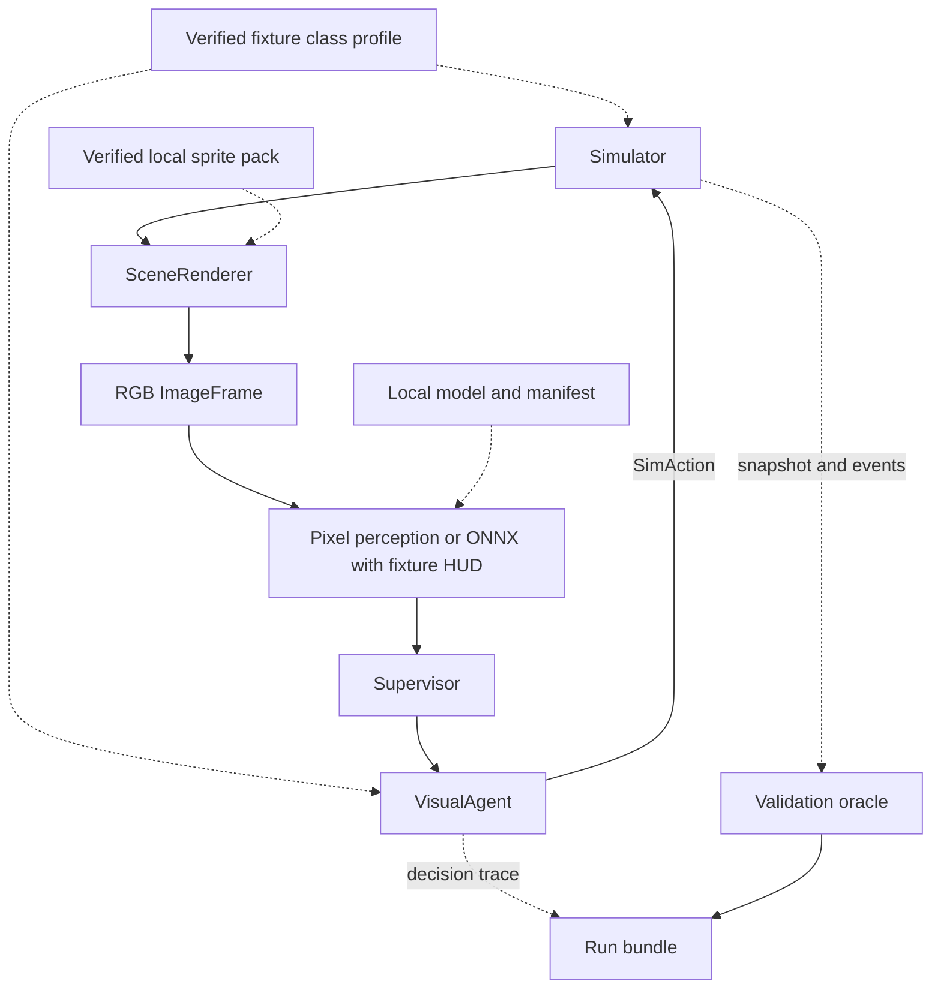

# v0.1 实际架构

本版本交付可安装的离线实验平台：本地知识与素材管理、合成数据、独立模拟器、像素基线、可选 YOLO/ONNX、任务闭环及证据回放。
所有内置职业、地图、技能数值均为 `synthetic-fixture-v1`，不代表国服实际规则。完整 v8.0 规格仍有外部数据与未实施功能；状态见 [实施计划](IMPLEMENTATION_PLAN.md) 和 [平台合同](../engineering/platform-contract.yaml)。

## 运行闭环与真值边界

`ImageFrame` 只含序号、时间、宽高、RGB bytes。`VisualAgent.decide()` 仅接受 `VisualObservation`；它可以读静态 `CLASS_SPECS` 或经过验证并显式注入的 catalog 职业配置，不能读 `Simulator`、snapshot、执行事件或渲染标签。
Supervisor 在策略前检查观测的新鲜度、顺序、资源是否可读及连续未知次数。暂停时发送模拟器 idle；终止后不继续执行任务。

动作仅进入 Python 模拟器的 `step()`。任务依次战斗、收集、NPC 对话、转图；动作后的可见变化由 `verify_visual_effect()` 记录。
“怪物消失”不会单独证明击杀，“执行器接受动作”也不会单独证明任务完成。独立 oracle 读取真值检查两张地图清理、掉落收集、NPC 对话和存活条件。

这里的隔离是代码接口和测试约束，不是进程权限沙箱。修改代码的调用方仍能访问 Python 对象；报告不能宣称具备强制信息隔离。

## 当前模块与连接关系

| 子系统 | 实际模块 | 当前连接与边界 |
|---|---|---|
| 知识目录 | `catalog.py`、`profiles.py` | 本地 v2 catalog；可把指定版本、VERIFIED 的完整合成职业参数同时注入模拟器和策略，来源与内容哈希随运行保存 |
| 素材目录 | `asset_registry.py`、`sprite_pack.py` | 校验本地注册图片后，按类别映射为可选 RGBA sprite；渲染与数据生成消费它们，默认几何素材保持兼容 |
| 模拟器 | `sim_types.py`、`simulation.py` | 3 个内置职业、2 张内置地图、固定时步、保存恢复、资源/战斗/拾取/对话 |
| 渲染与数据 | `scene.py`、`dataset.py` | 自绘几何素材、分层渲染、可见实例标签、会话分区与完整性验证 |
| 感知 | `vision.py`、`onnx_detector.py`、`agent.HybridPerception` | 基线读像素；ONNX 检测物体；地图/HUD/对话标记仍用合成场景解析器 |
| 录像与文字 | `recordings.py`、`ocr.py` | 本地 PNG/MP4 导入与逐帧观察、已安装 Tesseract 的有界 OCR；没有真实游戏 OCR 精度验收 |
| 模型工程 | `training.py`、`evaluation.py` | 本地 CPU 训练、ONNX 导出、真实推理及独立单 IoU AP；工具可用不等于模型质量通过 |
| 策略与监督 | `agent.py` | 有限任务状态机、静态职业能力、健康/魔法处理、有限卡住恢复、保守效果验证 |
| 验证实验室 | `lab.py` | episode、故障 suite、墙上时间 soak、文件哈希与确定性动作回放 |
| 兼容基础层 | `contracts.py`、`pipeline.py`、`knowledge.py` | 原 P0 opaque Frame、NoOp 管线与 SQLite v1 API 保留；不冒充新运行链路 |

这些连接以代码为准。职业注入仅覆盖 3 个已支持 job ID 的完整 ClassSpec，来源必须为 VERIFIED、无冲突的 synthetic_fixture；其它地图、怪物和机制仍为内置数据。
注册素材可进入静态渲染和数据工厂，alpha 同时参与画面与可见实例标签；没有动画状态机、锚点编辑器或任意地图/职业插件加载。`dataset create` 与 `lab run` 都可通过成对的 `--asset-registry ... --sprite-map ...` 显式选择素材；运行包复制源图片和 pack 元数据，回放不依赖原 registry。详见 [SPRITE_PACK.md](SPRITE_PACK.md)。

## 训练、推理和验证分离

数据工厂直接消费模拟器 snapshot 并通过渲染器生成标签；这是允许访问真值的数据制作阶段。
数据会话在 train/val/test 间互斥，足够会话时保证内置地图在各分区有样本。manifest 固定类别顺序、记录种子与哈希；验证拒绝跨分区重复图片和未登记图片/标签。

训练是独立 CLI 操作，使用本地 YAML、CPU 和本地数据；导出物为 ONNX、明确的输入尺寸/输出格式及内容哈希。
推理适配器不自动下载权重，只支持声明的检测输出格式。`vision benchmark` 可比较基线和指定 ONNX，输出精度、漏检、误检、时延与环境。
AP、实际任务成功率及账号风险是不同结论；前两者也仅在相应测试域内成立。

## 记录与回放的准确含义

运行包保存初末模拟器状态、完整动作 JSONL、按间隔采样的 PNG、最终 PNG、可选预览 GIF、摘要和文件哈希。启用 SpritePack 时另存原始图片与 `sprite-pack.json`，它们也纳入文件哈希和来源一致性检查。
`lab replay` 重新应用记录动作，检查执行回执、状态摘要、采样像素和独立任务条件。它不重新运行学习模型，返回 `perception_reproduced=false`。
因此这是确定性模拟器动作回放，不是把旧视频接入新动作后获得反馈的反事实环境，也不是实时录制系统。独立的 `recording import` 可以导入本地 MP4 或 PNG 序列，`recording observe` 只做离线逐帧观测，不产生动作反馈。

`lab suite` 和 `lab soak` 当前使用像素基线。指定模型的闭环使用 `lab run --model ... --manifest ...`，不能把默认 suite 的成绩归给 YOLO。
墙上运行时长和模拟时长分别记录；短运行或加速模拟不能验收 24 小时长稳。

## 尚未实现或尚无外部证据

没有已同步的小册子最新数据库、真实素材/真实录像精度验收、游戏专用 OCR 校准、学习式时序追踪/BeliefState、外部地图包或新职业代码插件、可视化编辑器或完整任务 DSL。
本地 OCR 和录像导入工具已实现，但需要用户安装 OCR 二进制/语言包并提供获准素材；工具存在不代表真实域准确率已通过。
聊天入口只生成用户给定回复的本地草稿；没有自动理解聊天、LLM 回复生成或消息发送后端。
正式客户端控制、输入伪装和反作弊绕过不在本平台范围内。独立模拟器结果不能证明正式账号安全。
