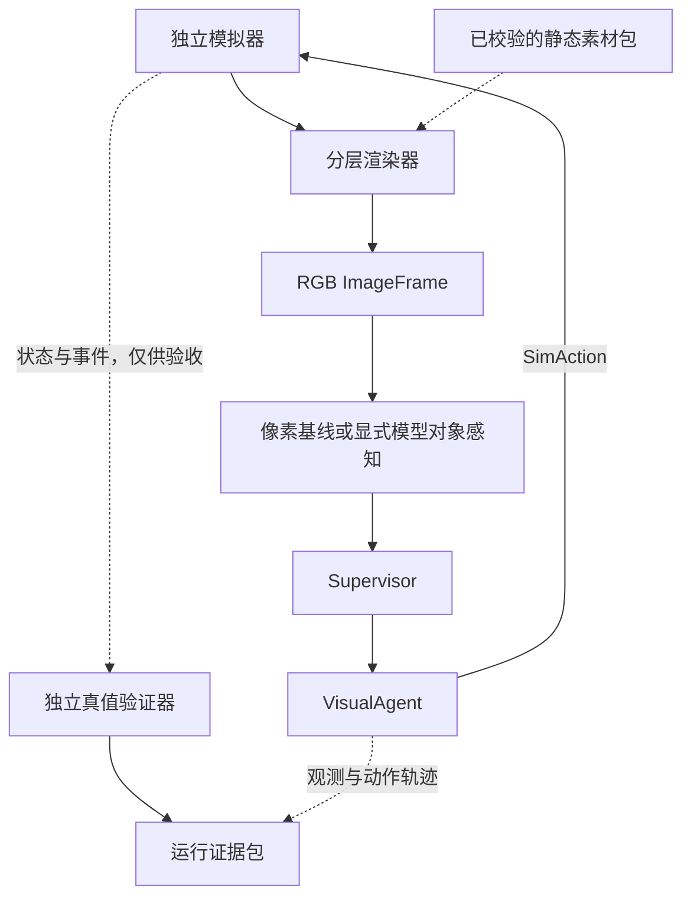

# Maple Vision Platform 最终实施方案

**现行总方案**　自 2026-11-26 起，产品终点、实施次序和发布门槛以[产品与验收总方案](LIVE_PRODUCT_PLAN.md)为准。下文保留 v8 离线底座的架构、复现说明和历史验收口径。

**原方案对齐（2026-11-25）：** 用户指定的[原始共享方案](https://chatgpt.com/s/t_6b05d66c4fac81918da3094a5f80f7dc)为《Maple Vision Platform v8.0 — 最终工程实施总纲》，完整 22 章正文现保存在 [MASTER_SPEC.md](../MASTER_SPEC.md)，图表和交互原型源文本另行保留。此前根目录总规格是摘要，本文件是实施与验收指南，两者当时都不是该链接原文的完整副本。后续以原文定义整体目标，以[逐章对照](PLAN_ALIGNMENT.md)跟踪未完成项，以具体版本证据判断是否通过；当前受限实现不能替代原方案目标。原文第 21 章“只开始 P0”保留历史原貌，用户之后已授权连续开发与测试。

**用途：交给另一名程序员或编程 AI，即可复现当前实现，并继续完成剩余工程。** 本文统筹 [v8 总规格](../MASTER_SPEC.md)、历史架构与版本验收，以及当前 **v0.6 内容和外部职业能力**。本轮执行顺序见 [V0_6_PLAN.md](V0_6_PLAN.md)，实际结果以发布验收和准确 head 的 PR 为准。旧版本验收、新实现可运行、当前版本发布通过、完整 v8 完成是不同状态。

当前代码还包括本机工作台、独立地图/平台寻路、持续伤害与控制技能、HTTPS 知识计划、录像人工标注评测、原视频逐帧时序以及可配置地图任务。使用入口见 [工作台](WORKBENCH_NAVIGATION.md)、[职业包](CLASS_PACKAGES.md)、[录像](RECORDINGS.md)与[任务程序](MISSION_PROGRAMS.md)。各增量的远端检查和合并状态以对应 PR 为准，下文版本数字保留历史范围。

## 1. 交付目标与当前结论

### 当前增量 v0.6

领域数据库、资源 SQLite 索引、动画时长/锚点与场景绑定、外部职业能力编译、统一任务中的有界组合技能、完整分层失败报告均已接入可执行入口。完整合同见 [v06-contract](../engineering/v06-contract.yaml)。弓手弹药、刀飞组合技能和 HP 消耗范围攻击使用自写规则，不代表国服数值；原有三职业和历史模型保持兼容。动画数据、职业规则和渲染源随运行保存，独立重放不依赖原文件。

实际调用和复现见 [V0_6_PLAN](V0_6_PLAN.md)、[领域库](CATALOG_DOMAINS.md)、[动画](ANIMATION_ASSETS.md)、[职业包](CLASS_PACKAGES.md) 与 [分层报告](FAILURE_BUNDLES.md)。`scripts/verify_content_platform.py` 是统一验收入口，报告实测任务、故障、删源恢复和短时墙钟结果。完整 v8 仍需两层图与导航、更多状态效果、复杂任务/库存、工作台以及真实数据/24小时等独立门禁。

### 已合并的 v0.5 状态与任务基础

当前增加 [时序状态估计](STATE_ESTIMATION.md) 与 [结构化任务运行时](TASK_RUNTIME.md)，执行合同见 [V0_5_PLAN](V0_5_PLAN.md)，实际验收统一记录在 [RELEASE_0_5_ACCEPTANCE](RELEASE_0_5_ACCEPTANCE.md)。原文中的 Task → Plan → Intent → Execution → Verification 已在显式 structured 路径中实际接通；独立候选、抢占、取消、顺序授权、效果证据和 N+1 帧重推理均由代码执行。旧 VisualAgent 继续作为默认兼容路径。

v0.5 通过准确 head `6552aeb7faccddd476f7a0c1c6f54e08cbd75919` 的三组 CI，已由 [PR #7](https://github.com/www1350/maple-vision-platform/pull/7) 合并。领域数据、动画和能力编译在 v0.6 继续；世界/平台图、完整状态技能、管理界面、真实录像准入与最终24小时仍按原总纲推进。下面旧版本数字保留对应历史范围，不代表后续增量或全部 v8 的成绩。

建立一个本机可运行的闭环：有来源的知识与素材进入独立模拟世界；渲染生成图像，视觉模块理解图像，策略决定动作，模拟器执行动作，独立验证器核查结果。使用者能自己复现成功和失败，不需要拿正式账号试错。

当前具备 SQLite 知识目录、静态素材登记与渲染、会话级合成数据集、实际 YOLO 训练和 ONNX 推理、三职业两地图任务、故障测试、动作重放、录像观察与本地 OCR。v0.2 的知识增量计划、生命周期数据与分组评估、模型 suite/soak、资源采样和实际感知/策略重新执行已经验收；所选 lifecycle 模型只取得合成混合管线准入。其源代码、模型及测试提交 `f17e7487f5938acfaf312e05b8eecb242f06a492` 的[三项远端 CI](https://github.com/www1350/maple-vision-platform/actions/runs/45394348732)均已通过，最终归档与合并历史见 [PR #3](https://github.com/www1350/maple-vision-platform/pull/3)。

v0.4 在保留两张内置地图的基础上增加显式外部 MapPack，已接入模拟器、渲染、三职业任务、数据生成及自包含重放。示例有 `grove / quarry / ruins` 三张新地图；结构支持固定画布下 2–8 图循环路线。新增地图工程以像素基线独立验收，没有训练新模型，也没有证明原 YOLO 在新地图上的准确率。[地图格式与使用](MAP_PACKS.md)

v0.4完整本地1011通过、0跳过，隔离wheel通过；三职业分别559/519/507步完成，实际重新感知560/520/508帧；13场景、486帧数据与61.05秒53轮短时运行通过。首次Windows因超长pytest参数ID产生一个用例的setup/teardown错误，仅修改用例ID后，修复实现`8a649f8aaa88429d7a7da2415f29dc632ccf5d42`已通过[三组远端CI](https://github.com/www1350/maple-vision-platform/actions/runs/45455031462)与两平台隔离安装。生产代码和原始测试输入/断言未变。像素val仍有40FP/12FN，不宣称完美感知；最终归档head的检查和合并由[PR #5](https://github.com/www1350/maple-vision-platform/pull/5)记录。

v0.3增加结构审查、schema3几何评分和显式模型对象模式；候选14项阈值通过13项，但平台召回0.819444＜0.98，依协议不推广、不评分test、不执行候选推广任务或再训第二候选。日志流工程修复后完整本地834通过，准确实现提交的三组 CI 通过；最终归档 head `f1c9fc143c35e4ce7849410d6b13df3bcf0a3df6` 也已通过 [CI 45423871093](https://github.com/www1350/maple-vision-platform/actions/runs/45423871093)，经 [PR #4](https://github.com/www1350/maple-vision-platform/pull/4) 合并为 `493b7d24688c6aad22d7583f11e8098a28965567`。该轮工程已闭合，模型拒绝结论保持不变。

本项目执行对象是独立 Python 模拟器。正式客户端控制、系统按键注入、输入伪装、封包/内存修改和反作弊绕过不在交付范围内；独立验证也不能证明正式账号不会被封。玩家回复只产出待人工确认的本地草稿。依赖安装后，默认运行、训练、推理和 OCR 使用本地计算，不调用 LLM API，不消耗运行时 LLM token；编程 AI 开发本身的计费另算。

## 2. 总体架构与信息边界



知识目录向模拟器和策略提供**同版本静态职业参数**；它不能向策略泄露玩家位置、怪物血量或其他动态真值。训练支路可以从模拟器状态生成正确标签，运行支路不能读取这些标签。当前隔离由接口、依赖方向和测试约束实现，并非进程权限沙箱。

核心接口已经存在：

| 边界 | 当前合同 |
|---|---|
| 模拟器 | `Simulator.step(SimAction) -> StepOutcome`；固定时间步、可保存恢复 |
| 图像 | `ImageFrame(sequence, timestamp_ms, width, height, pixels)`；只含 RGB bytes 与帧身份 |
| 对象检测 | `Detector.detect(frame) -> tuple[Detection, ...]`；框为原图 xyxy |
| 感知 | `observe(frame) -> VisualObservation`；对象、HP/MP、地图、对话可见性及来源 |
| 监督与策略 | `Supervisor.inspect(observation, now_ms)`；`VisualAgent.decide(observation)` |
| 独立验证 | 可读模拟器 snapshot；核验目标完成、状态与采样画面，不能反馈隐藏答案给策略 |

`VisualObservation` 明确区分已知与未知；没有测量依据的字段保持 `None`，置信度不是天然校准概率。原 P0 的 opaque `Frame`、NoOp `Pipeline`、v1 数据库接口保留兼容，不能将其占位合同误当成当前 RGB 链路。字段与签名以 [API_CONTRACTS.md](API_CONTRACTS.md) 为准。

## 3. 知识底座：先离线固化，再做可追溯更新

职业、技能、怪物、掉落关系、地图、道具、NPC、任务等相对稳定资料，应从**允许使用的小册子导出或其他已获准来源**预先整理。候选参考来源为 [冒险岛小册子](https://mxdc.dvg.cn/)；当前仓库没有已经采集好的最新国服数据库，也没有自动网络同步器。

现有落地流程是：本地 JSON 导出 → 严格校验 → SQLite v2 事务导入 → 冲突检查 → 只读查询/快照。每条记录绑定实体 ID、游戏版本、源 URI、采集时间、许可说明、scope、核实状态、payload 及内容哈希。同版本矛盾候选全部保留为 `CONFLICTED`；`UNKNOWN`、`PROVISIONAL` 不自动升级。默认只查询 `VERIFIED`，版本不匹配或无数据时明确缺失，不用猜测填空。[目录格式](CATALOG.md)

当前只有三个已支持职业的完整 `ClassSpec` 真正接入运行：必须同版本、全部 VERIFIED、无冲突且属于 `synthetic_fixture`。12 个字段覆盖资源上限、基础伤害/距离/消耗/冷却、弹药、跳标、治疗、移动和跳跃速度。运行包保存参数与来源哈希，删除原数据库后仍能重放。地图、怪物、通用 Buff/药品等条目目前不会自动改变规则。[职业注入](CLASS_PROFILES.md)

**v0.2 已实现本地增量计划：** `LocalExportSource` 按现有严格导出格式捕获原字节，`knowledge plan-sync` 保存源哈希、来源/版本、完整目录基线和 added/unchanged/changed/missing 差异。`apply-sync` 重算计划，并在同一 `BEGIN IMMEDIATE` 事务中检查基线、导入和预期结果；过期或篡改计划失败，完整预期结果已经存在时显式幂等。missing 仅表示旧证据未出现在这次导出中，不删除历史、不解除冲突、不自动核实。计划哈希不是签名或批准凭据。[增量合同](KNOWLEDGE_SYNC.md)

**后续仍未实现：** 网络来源适配器、最新小册子数据、持续调度与其余知识类型的规则映射。新计划应用成功也不会自动热替换任务规则；需要新建、核验并显式选择运行快照。“页面能打开”与“资料可以使用”需要分别确认。

## 4. 素材、地图与场景管线

现有 `Asset Registry` 接收本地单帧 PNG/JPEG/WEBP，验证解码后按内容哈希保存原文件，同时记录来源与授权说明。`SpritePack` 将七个检测类别中的一个或多个映射到已登记的 asset ID，可同时用于 `dataset create` 与 `lab run`。RGBA 图按实体框缩放；透明度同时影响真实渲染和可见实例标签。运行包复制素材与 pack 元数据，回放不再依赖原注册表。[素材接入](SPRITE_PACK.md)

地图已经分离背景/视差、装饰、平台/梯子、动态对象和 HUD；默认画布 320×192。内置 `meadow`、`cavern` 保留较窄视口的镜头变换行为。实体碰撞几何与图片外观分离，更换图片不会自动导入新碰撞结构、动画或技能规则。

**v0.4 当前接口：** `load_map_pack(path) -> MapPack` 严格读取最多128KiB的本地JSON；不可变对象包含来源声明、内容版本、2–8张地图、唯一RGB标记与完整循环路线。每图声明平台、梯子、单门、单NPC、出生位置及地面怪物位置；固定世界/视口320×192、地面y=168。门必须指向路线下一图，末图返回入口；越界、重复身份、非法类型和错误哈希均拒绝。`map_pack=None` 保持旧默认字节；显式注入使用存档schema3，完整内容随存档恢复，不需要原文件。

三图样例为 `examples/maps/three-map-fixture.json`，`grove → quarry → ruins → grove`，共9怪。`maps check`只证明结构和身份；资源、遮挡、策略和步数仍影响任务完成。运行独立oracle由声明路线和怪物总数计算目标，不能写死两图六怪。感知只得到静态标记表，策略只得到路线ID；两者不读取几何或动态真值。[完整地图合同](MAP_PACKS.md)

**剩余工作：** 更广世界坐标和镜头、分支传送、复杂平台怪物、可达性规划、图层编辑和动画状态/时长/锚点。MapleNecrocer等工具仍为待评估候选，许可、输入兼容性与输出质量未验收。当前有界地图包不等于完整地图编辑器或动画管线。

## 5. 数据集、YOLO 与视觉状态

### 5.1 数据制作

`dataset.py` 从多种子模拟会话生成 RGB 图片与可见框，类别为 player、monster、loot、portal、npc、platform、ladder。框裁剪到画面；被遮挡而不可见的实例不凭真值强行标出。train/val/test 按完整会话分开，manifest 记录种子、会话、类别、图片/标签及 `data.yaml` 哈希。校验拒绝越界标签、跨分区重复图片、遗漏文件、未登记文件和路径逃逸。[视觉实现](VISION_IMPLEMENTATION.md)

v0.1 的 288 帧数据缺少 x<40 的玩家样本，而模拟器起点 x=24。v0.2 的显式 `profile="lifecycle"` 新增 schema v2：用实际模拟动作走完两图战斗、收集、对话和往返，选取出生、战斗、拾取、清场、对话、切图六阶段及边缘、高台、非落地位置。校验器逐会话重放动作，独立核对所选画面、可见标签、阶段和覆盖统计；训练生成可读取真值，运行检测器仍只接收 RGB 帧。默认 legacy 生成器和旧数据字节保持兼容。[生命周期合同](DATASET_LIFECYCLE.md)

v0.4 显式 `map_pack` 仅与 lifecycle 配合，采用 dataset schema3，manifest完整内嵌地图及摘要。每会话最低`6×地图数`帧，每图六阶段均须覆盖；轨迹最多4096步，不能完成时清理临时目录并拒绝发布半成品。验证器用内嵌包重算动作、像素、可见标签与统计；评估按实际地图ID分组。原数据生成和训练私有副本流程保留兼容。本轮18×27=486帧只用于工程和像素基线检查；所有分区都包含同一地图包，不构成学习模型未见地图验收。

v0.2 冻结输入为 18 会话×48 帧，共 864 张图片、7098 个可见标注，train/val/test 为 480/192/192 帧；manifest SHA-256 为 `670f6dae181f0f4b3107ba6a47cb733f19cfbc216c4e8e8c23f96b756601b3ff`。三职业、两地图、六阶段及五种位置分组均有覆盖。分组评估重新计算每组 TP/FP/FN/AP，保留聚合结果；无怪物真值时的误检仍计 FP。v0.3 另建新种子、无完全相同RGB和会话种子交集的数据，身份见5.4节。两版的两张地图仍在各分区出现，会话隔离和生命周期覆盖不等于未见地图或真实域泛化。

### 5.2 训练与推理职责

YOLO 是学习图像中对象位置和类别的检测模型；它不负责理解技能规则或完成任务。当前 tiny 结构从本地 YAML 随机初始化，CPU 训练，单独导出 ONNX，再由真实 ONNX Runtime 推理。训练使用私有数据副本，第三方缓存不会污染源数据集；模型 manifest 绑定权重哈希、类别顺序、输入尺寸、输出格式与适用域。

默认 `PixelPerception` 是几何样例专用颜色基线。v0.2兼容的模型模式使用 **YOLO 检测玩家/怪物/掉落/NPC/门，像素方法读取平台/梯子/HUD/地图/对话标记**。v0.3 显式 `--terrain-source model` 将平台与梯子也交给模型，缺失对象不以像素回退补成模型成绩；HUD/地图/对话仍是fixture解析。该新路径已经接入接口，候选能否通过任务与质量门禁另行记录。自定义素材必须训练或提供适配检测器，不能期待原调色板解析器自动识别。

v0.2 让同一个显式 ONNX 实例进入 suite/soak，并在新运行包中记录实际加载模型哈希、manifest、阈值和终止观测。`lab reinfer` 从初始画面起实际执行每帧感知、监督和策略，比较新计算的观测与动作；它不把记录动作当作新策略输出。预检资源/文件变化边界和保留实际失败轮次一次已完成本地审查与回归，详见 [模型验证](MODEL_VALIDATION.md)。

本地 Tesseract 适配器可以识别指定图像区域文字，但尚无游戏中文小字、聊天栏或真实 HUD 准确率验收，也没有自动接入任务策略。完整时序跟踪、目标身份、WorldState/BeliefState 融合属于后续工程：需保留测量时间、来源、有效期和不确定性，不能把上次估计永久当真。[训练](TRAINING.md) · [评估定义](EVALUATION.md) · [录像与 OCR](RECORDINGS.md)

### 5.3 v0.2 已验收 lifecycle 模型、实际结果与边界

v0.2 的所选模型位于 `examples/lifecycle-model/`，SHA-256 为 `7e9f61576f63be400909db6f9eb6cb89b5b935385d01a24155c7f765d2beb6e3`。它采用 320px、40 epoch、batch 8、seed 42、CPU 2 线程，从本地配置随机初始化，实际训练耗时 **1067.895699 秒**。来源、权重与完整结果见 [YOLO_LIFECYCLE_EXPERIMENT.md](YOLO_LIFECYCLE_EXPERIMENT.md)。

在同一份 v0.2 数据的 192 帧 val 上比较：

| 模型 | AP50 | platform recall |
|---|---:|---:|
| v0.1 旧模型 | 0.900697 | 0.467014 |
| v0.2 lifecycle 模型 | 0.946252 | 0.661458 |

v0.2 工程准入要求在首个候选 val 之后制定，**没有预注册**。选模同时参考其 val 与明确单列的合成任务套件，于 **2026-11-24 12:06:01 UTC** 固定候选；随后只评估一次保留 test，不据 test 调参。该 test 为 192 帧、1572 个真值目标，TP=1372、FP=3、FN=200；AP50=**0.944822452**、micro precision=**0.997818182**、recall=**0.872773537**。AP50 是指定置信度截断后的单 IoU 指标，不是完整 COCO mAP50–95。

混合管线的三职业任务分别用 **327/325/317 步**完成，独立目标核验通过；实际 reinfer 分别重新执行 **328/326/318 帧**感知与策略，包含终止帧。模型 suite **13/13** 场景符合预期；60 秒 soak 请求实际运行 **61.510525 秒**、完成 **10 轮**，有 **63** 个资源样本，最大采样当前 RSS **90.09375 MiB**。这些本地门禁支持本次合成混合管线模型准入，不能推导真实域或 24 小时可靠率。[发布证据](RELEASE_0_2_ACCEPTANCE.md)

**v0.2 模型没有通过纯模型地形准入。** 对实际 ONNX 的检查确认 `reg_max=8`、stride=4/8；每边距离由 0…7 的 DFL bins 表示，单框宽度上界为 `2×(8−1)×8=112px`。当前全宽地板为 320px，单框 IoU 上界为 `112/320=0.35`，达不到评估 IoU=0.5。这解释了其 val 中 192 个全宽地板漏检，不能据此解释剩余其他错误。直接添加 stride32 分支虽然扩大理论框宽，但当前 320 输入/4px 地板几何下实际匹配器给该分支 **0 个可用地板正样本锚点**，因此没有训练这个无效候选。详见实验报告中的实际架构与锚点检查。

已验收闭环保留YOLO动态对象加像素地形/HUD，不把混合成功写成纯模型地形通过，也不修改标签隐藏架构限制。v0.3按这些结构证据完成了下节的单候选实验；新候选解决全宽地板后仍未达到总体平台门禁，明确不推广。

v0.1 样例与历史数据仍保留在 `examples/fixture-model/` 和 [YOLO_EXPERIMENT.md](YOLO_EXPERIMENT.md)。其原 test 是 64 帧、633 个目标、AP50=0.92645、平台 recall≈0.4948，三职业原任务为 327/349/317 步；不同数据的旧 test 数字不应直接用来估计模型提升。默认像素基线也没有被静默替换。

### 5.4 v0.3 已实现工具与未推广候选

| 当前新增接口 | 实际职责 | 保持的验收边界 |
|---|---|---|
| `model audit-terrain` | 仅在train/val审查真实检测头、stride/DFL、正样本与完整四边目标；记录随机权重CPU前向成本 | 可表达、可分配和训练后学会是不同结论；不接受test作为结构选择来源 |
| `vision benchmark --terrain-metrics` | schema3追加`terrain_geometry`；复用同批预测，全部平台一对一匹配后再分层全宽地板 | 未命中仍计FN，几何误差只统计匹配框；空指标不能算通过 |
| `--terrain-source model` | 七类对象来自ONNX，pipeline=`onnx-all-objects+fixture-hud-v1`；同来源进入run/suite/soak/reinfer | 无地形像素回退；HUD仍是fixture；接口实现不自动授予模型准入 |

新数据seed=2026112603，18×48=864帧、7091对象，train/val/test为10/4/4会话、480/192/192帧；manifest SHA-256为 `f73d7390980fa6aedea3b3a12ada2f0a8f3658519e0ca435ca93414bbd02aac4`。与旧两版数据的解码RGB完全重复为0、会话种子无交集，新数据跨split重复也为0。地图仍完全相同，192帧test来自4个会话，不是192个独立世界。

[不可变预注册](../reports/release-0.3.0/preregistration.json)于2026-11-24 13:51:15.597437 UTC冻结，早于候选训练及候选验证。旧模型在新val的基线已先行查看：AP50=0.944829974、platform recall=0.664930556；不把v0.2原数据分数作为本轮阈值。唯一候选为 `configs/terrain-yolo.yaml`，实际reg_max16、stride4/8/16；地板20个合格stride16锚点中10个具有未截断的完整四边目标。

唯一候选完成40epoch、320px、batch8、seed42、Torch2线程训练，实际耗时1467.923792秒。同新val的AP50为0.9646245103、microP/R为0.9993150685/0.9298916507，TP/FP/FN为1459/1/110。全宽地板192/192命中，顶边及两端点p95误差通过；ORT1线程detect p95为24.98615355ms。**总体平台只有472/576命中，recall=0.8194444444，未达到0.98，因此整体模型拒绝推广。**

失败ONNX SHA-256为 `be5cd99bce0f52b0cdfc7e033251f2c919e14d203c8b72d394a18d7a067751f0`，保留位置是 `examples/terrain-candidate`。评分及门禁证据归档为 [terrain-model-validation.json](../reports/release-0.3.0/terrain-model-validation.json) 和 [validation-gates.json](../reports/release-0.3.0/validation-gates.json)；详细val分析由 [YOLO_TERRAIN_EXPERIMENT.md](YOLO_TERRAIN_EXPERIMENT.md)维护。已验收的 `examples/lifecycle-model` 混合模型不变。

按预注册，候选推广13场景、三职业reinfer、soak及test均不执行，不增加第二候选。新test字节允许用于完整性核对与训练副本复制，但没有产生模型预测或分数。这是已经执行的失败出口，不是接手AI应补做的遗漏步骤。

正式40epoch训练与val评分期间，五项冻结源码保持预注册字节，1730个输入副本文件一致；历史训练实现可从 `ff357c8951da8e84265d31c5a8b86a48934a4f01`读取。实验结束后，CI顺序触发日志handler关闭流问题，`training.py`另作工程修复；该修复不追溯进入实验，原模型和报告不变。后加审查预算同样不能追溯计入早期审查。修复后完整834项、同序155项、日志13项及重建wheel均通过，实现提交3340d8f的三组远端CI也已通过；最终归档提交也已通过CI并由PR #4合并。[修复来源与回归](../reports/release-0.3.0/runtime-stream-fix.json)

## 6. 职业能力、任务与有界监督

| 范围 | 当前实现 | 扩展要求 |
|---|---|---|
| 标飞 `assassin` | 远程基础攻击、弹药消耗、跳标组合 | 新技能必须定义前置条件、消耗、冷却与可见效果 |
| 龙骑 `dragon_knight` | 近战与范围技能差异 | 攻击区域、命中与多个目标独立测试 |
| 牧师 `cleric` | MP 差异与自我治疗 | 治疗量、MP 不足和动作拒绝测试 |
| 通用动作 | 移动、单段跳跃、梯子、拾取、HP/MP 药品、Buff、NPC 对话、传送门 | 新动作须同时有执行合同和验证方法 |
| 任务 | 两张内置图或外部包的有序多图战斗→收集→NPC 对话→旅行状态机 | 当前只支持单出口循环内容；通用任务 DSL、分支任务图尚未实现 |
| 玩家回话 | `chat-draft` 封装用户提供的回复，`sent=false` | 自动理解、LLM 生成与发送后端均未实现 |

职业不等于一组按键脚本。新增职业要显式描述能力并验证模拟行为；当前三个 job ID 之外没有外部职业插件加载器。后续职业包可以提出数据 Schema，但在加载器、版本迁移与回归完成前不能称为现有 API。[模拟器行为](SIMULATOR_IMPLEMENTATION.md)

模拟器默认固定 50ms 时间步和随机种子，状态保存包含确定性恢复所需信息。策略根据画面血蓝与对象关系处理生存、资源、战斗和任务进度；动态库存并没有通过隐藏真值或完整 OCR 输入策略。执行回执 `accepted` 只表示动作被接受，可见目标消失也不能单独证明击杀或拾取归属。

Supervisor 默认检查250ms新鲜度、帧序号/时间与资源可读性，连续未知预算为12步；策略有卡住恢复和战斗进度预算，单独run默认最多1000步且可显式配置。外部包suite/soak每轮预算为`max(1000,500×地图数)`。短暂故障允许恢复，持续未知停止，无法恢复的输入冻结有界失败。oracle核验声明路线全部地图清理、真实击杀数与掉落收集、每图NPC对话和存活；策略自称完成而oracle不通过必须记失败。

## 7. 录像、重放与运行证据

四种证据要分别使用：

| 模式 | 可以验证什么 | 不能由此证明什么 |
|---|---|---|
| 本地 PNG/MP4 导入与观察 | 文件/像素完整性、帧序、已有画面的感知输出 | 无标注就没有准确率；固定录像不能响应新动作 |
| `lab replay` | 从初始状态重放实际动作，复核状态、事件、采样像素与任务结果 | 不重新运行原模型，明确 `perception_reproduced=false` |
| `lab reinfer` | 新版运行包中实际重新执行感知、监督与策略；比较完整观测、决策与终止状态 | 需要同一模型身份和阈值；旧包缺少证据时拒绝；复现失败任务不等于任务成功 |
| 模拟器交互闭环 | 执行动作后产生新状态，再观察并验证效果 | 自建规则不会自动证明正式规则或账号安全 |

每次输出新目录，保存 summary、完整 trace JSONL、初末状态、采样 PNG、最终画面、预览与文件 manifest。可选职业参数和素材随包保存；记录模型/数据哈希、配置、种子与运行版本。哈希检测内容变化，不是来源真实性的签名。MP4 当前时间戳按名义 FPS 估算，不是精确逐帧 PTS，不能用来推断毫秒级技能时序。[数据格式](DATA_SCHEMAS.md)

外部地图另保存`map-pack.json`，与schema3存档、summary以及perception settings的地图摘要绑定。replay先核验地图副本与声明种子的初始世界，再重放全部动作；reinfer从内嵌地图重建感知/策略并比较N+1帧，包含终止帧。原文件删除不影响这两种验证。地图与职业参数、SpritePack可以共同嵌入；格式合法不代表自定义图片可由像素基线识别。

## 8. 从零复现：实际可执行命令

以下在仓库根目录使用 Python 3.12；所有实验输出路径必须是新路径。Linux 初始化：

```bash
python3.12 -m venv .venv
source .venv/bin/activate
python -m pip install -r requirements-dev.txt
python -m pip install --no-build-isolation --no-deps -e .
python -m pip check
```

Windows 用 `py -3.12 -m venv .venv` 创建环境，后续将 `python` 替换为 `.\.venv\Scripts\python.exe`，无需修改系统执行策略。平台差异与完整安装说明见 [QUICKSTART.md](QUICKSTART.md)。

### 8.1 先验证工程闭环

```bash
python -m maple_vision lab run --output artifacts/plan-assassin --job assassin --seed 0
python -m maple_vision lab replay artifacts/plan-assassin
python -m maple_vision lab run --output artifacts/plan-knight --job dragon_knight --seed 1
python -m maple_vision lab run --output artifacts/plan-cleric --job cleric --seed 2
python -m maple_vision lab suite --output artifacts/plan-suite --seeds 3
python -m maple_vision lab run --output artifacts/plan-yolo --model examples/lifecycle-model/model.onnx --manifest examples/lifecycle-model/manifest.json
python -m maple_vision lab replay artifacts/plan-yolo
```

前五条使用像素基线；模型命令使用混合感知。正常 episode 要同时检查 `status=completed` 和 `independent_goal_check`。CLI 正常返回 0，明确失败/停止返回 1，参数或文件校验错误返回 2；故障套件按预期停止也可算测试通过。

### 8.2 导入静态知识与素材

上述运行会创建 `artifacts`；若单独从此节开始，先创建该父目录。

```bash
python -m maple_vision knowledge init artifacts/plan-knowledge.sqlite
python -m maple_vision knowledge plan-sync artifacts/plan-knowledge.sqlite fixtures/knowledge-demo.json artifacts/plan-knowledge-sync.json
python -m maple_vision knowledge apply-sync artifacts/plan-knowledge.sqlite artifacts/plan-knowledge-sync.json
python -m maple_vision knowledge query artifacts/plan-knowledge.sqlite classes assassin fixture-v1
python -m maple_vision knowledge snapshot artifacts/plan-knowledge.sqlite artifacts/plan-snapshot
python -m maple_vision knowledge verify-snapshot artifacts/plan-snapshot
python -m maple_vision lab run --output artifacts/plan-profile --knowledge-db artifacts/plan-knowledge.sqlite --game-version fixture-v1
```

`knowledge-demo.json` 是合成测试资料。先查看计划中捕获的证据与差异，再应用；原来的 `knowledge import` 仍可用于直接原子导入。素材须先准备自己创作或获准使用的本地图片；登记命令、映射 JSON 和实际授权字段见 [SPRITE_PACK.md](SPRITE_PACK.md)。随后对 `dataset create` 与 `lab run` 成对增加 `--asset-registry REGISTRY --sprite-map MAPPING.json`。替换素材后应重训检测器并重新验收，现有模型没有任意画风兼容承诺。

### 8.3 复现已验收的 v0.2 模型流程

```bash
python -m maple_vision dataset create artifacts/plan-data --profile lifecycle --sessions 18 --frames 48 --seed 20261125
python -m maple_vision dataset check artifacts/plan-data
python -m maple_vision vision benchmark artifacts/plan-data --output artifacts/plan-pixel-val.json --split val
```

真正训练前安装固定的可选训练环境；安装需要网络，训练消费本地数据：

```bash
python -m pip install --no-deps --index-url https://download.pytorch.org/whl/cpu torch==2.15.0+cpu torchvision==0.29.2+cpu
python -m pip install -r requirements-training.txt
python -m pip check
python -m maple_vision model train artifacts/plan-data --output artifacts/plan-train --epochs 40 --image-size 320 --batch 8 --seed 42
python -m maple_vision model export artifacts/plan-train/run/weights/best.pt --output artifacts/plan-export --image-size 320
python -m maple_vision vision benchmark artifacts/plan-data --output artifacts/plan-yolo-val.json --split val --model artifacts/plan-export/model.onnx --manifest artifacts/plan-export/manifest.json
```

以上复现 v0.2 所选候选的 320px、40 epoch、batch 8、seed 42 配置；原运行训练耗时 1067.895699 秒，实际权重与结果见 [v0.2 实验](YOLO_LIFECYCLE_EXPERIMENT.md)。重新训练的时间与字节不保证跨环境相同。v0.1 历史实验使用旧版数据，复现时应采用其原数据命令。3 epoch 可用于流程 smoke，不能作为质量验收。Python API 与 CLI 的默认输入尺寸不同，实验命令始终显式指定。调参只看 train/val；旧test已经公开查看，重跑它只是历史复现，不能作为v0.3的新独立holdout。

固定候选权重与选模理由后，再执行保留 test 和独立任务检查：

```bash
python -m maple_vision vision benchmark artifacts/plan-data --output artifacts/plan-yolo-test.json --split test --model artifacts/plan-export/model.onnx --manifest artifacts/plan-export/manifest.json
python -m maple_vision lab run --output artifacts/plan-new-model --model artifacts/plan-export/model.onnx --manifest artifacts/plan-export/manifest.json
```

新运行包可用同一模型做实际重新推理，再把该模型显式用于矩阵与短时长稳：

```bash
python -m maple_vision lab reinfer artifacts/plan-new-model --model artifacts/plan-export/model.onnx --manifest artifacts/plan-export/manifest.json
python -m maple_vision lab suite --output artifacts/plan-model-suite --seeds 3 --model artifacts/plan-export/model.onnx --manifest artifacts/plan-export/manifest.json
python -m maple_vision lab soak --output artifacts/plan-model-soak --seconds 60 --resource-interval 1 --max-resource-samples 1024 --model artifacts/plan-export/model.onnx --manifest artifacts/plan-export/manifest.json
```

输出包括实际墙钟、进程 CPU 和支持平台上的 RSS 来源与单位；未知内存保持 `null`。资源样本有界保留，最大采样值不能冒充精确瞬时峰值。预检/文件变化防护和原始失败包保留已有v0.2回归证据；v0.3最终提交已经取得独立CI并合并；当前外部地图以v0.4验收为准。

### 8.4 v0.3 结构、几何与模型对象入口

完整复现命令见 [V0_3_PLAN.md](V0_3_PLAN.md)。唯一训练及val已经完成且失败，工程及最终归档也已合并。接手者不得再起候选、评分test或执行该失败候选的推广任务；应继续v0.4之后的独立工程增量。以下只展示允许在train/val使用的结构和几何入口；输出不得覆盖现有证据。

```bash
python -m maple_vision model audit-terrain artifacts/v03-repeat/dataset --config configs/terrain-yolo.yaml --output artifacts/v03-repeat/structure.json --split train --image-size 320
python -m maple_vision vision benchmark artifacts/v03-repeat/dataset --split val --terrain-metrics --model artifacts/v03-repeat/export/model.onnx --manifest artifacts/v03-repeat/export/manifest.json --output artifacts/v03-repeat/validation.json
```

`vision benchmark`直接评估检测器，不使用混合感知补全对象；默认split是test，所以候选比较必须明确`--split val`。`lab run/suite/soak/reinfer`的模型对象入口仍是成对model/manifest加`--terrain-source model`，运行和复验不能更换来源身份；该工具接口的存在不允许越过当前候选的val失败出口。

### 8.5 本地录像、OCR 与草稿

准备有权分析的 `./recording-frames` PNG 目录，文件名补零，下面授权说明应替换为真实情况：

```bash
python -m maple_vision recording import ./recording-frames artifacts/plan-recording --source-uri urn:my-recording:session-001 --permission explicit_permission --license "Owner-provided recording; local analysis permitted" --fps 20
python -m maple_vision recording check artifacts/plan-recording
python -m maple_vision recording observe artifacts/plan-recording --output artifacts/plan-observations
python -m maple_vision vision ocr artifacts/plan-recording/frames/000000.png --language eng
python -m maple_vision chat-draft --incoming "现在有空吗？" --reply "稍等，我忙完回复你。"
```

OCR 需要本机 Tesseract 与对应语言包；中文需自行安装并验证 `chi_sim`，程序不自动下载。MP4 还需要可选 OpenCV/FFmpeg。录像感知可成对提供 `--model --manifest`，但这些检测框不会自动补全真实地图与血蓝状态。

### 8.6 外部地图包与独立验收

```bash
python -m maple_vision maps check examples/maps/three-map-fixture.json
python -m maple_vision lab run --map-pack examples/maps/three-map-fixture.json --output artifacts/plan-three-maps
python -m maple_vision lab replay artifacts/plan-three-maps
python -m maple_vision lab reinfer artifacts/plan-three-maps
python -m maple_vision dataset create artifacts/plan-map-data --profile lifecycle --map-pack examples/maps/three-map-fixture.json --sessions 18 --frames 27 --seed 20261125
python -m maple_vision dataset check artifacts/plan-map-data
python -m maple_vision vision benchmark artifacts/plan-map-data --split val --output artifacts/plan-map-pixel-val.json
python scripts/verify_external_maps.py --output artifacts/plan-map-acceptance
```

最后一条是可交给下一名编程AI直接执行的完整本轮验证：三职业、13场景、动作重放、每帧重新感知/策略、486帧数据、实际地图分组和默认60秒墙钟运行。全程使用像素基线，不加载学习模型；加载器的临时输入路径在检查前删除，报告与原始包保留。实际结果见[v0.4验收](RELEASE_0_4_ACCEPTANCE.md)，JSON字段与边界见[地图包说明](MAP_PACKS.md)。

## 9. P0–P13 工作拆解与依赖

按已验收基础与本轮v0.4接口继续现有仓库，不重建已有基础设施；v0.3模型失败分支已关闭。实际机器可并行处理独立模块，集成前先冻结合同。机器可读依赖见 [milestones.yaml](../engineering/milestones.yaml)。

| 阶段 | 前置 | v0.2 已验收离线基础 | 完整目标仍需的工作 |
|---|---|---|---|
| P0 工程基础 | 无 | 合同、CLI、v1 SQLite、CI 与兼容回归 | 保留历史验收，不改写旧成绩 |
| P1 知识 | P0 | v2 导入/冲突/快照、职业配置注入、本地增量计划与原子应用 | 网络来源与持续调度、最新核实数据、其余规则映射 |
| P2 素材 | P0 | 注册、校验、静态 SpritePack | 授权真实资源、动画与锚点 |
| P3 地图渲染 | P1/P2 | 内置两图、分层/透明度、v0.4有界外部地图与几何/循环路线校验 | 更广世界/镜头、分支地图、可达性规划和编辑 |
| P4 数据 | P3 | legacy v1、生命周期 v2、外部地图 v3、动作/像素/标签/覆盖重放 | 未见地图留出研究、真实标注、更多遮挡与跨域覆盖 |
| P5 模拟器 | P0/P3 | 固定步长、物理/战斗/资源/保存恢复 | 更多机制、经核实的规则校准 |
| P6 模型 | P4 | 训练、导出、分组指标、所选 lifecycle 模型混合管线准入 | 本轮地形候选未通过，保留证据；后续视觉研究须另立协议，真实域未准入 |
| P7 视觉状态 | P5/P6 | 对象、样例 HUD、本地 OCR | 时序追踪、真实 UI、BeliefState |
| P8 职业 | P1/P5 | 三职业与严格参数注入 | 全职业数据、外部能力包 |
| P9 任务 | P7/P8 | 声明路线多图任务、视觉效果与动态目标 oracle | 通用任务 DSL、分支任务图和导航 |
| P10 监督 | P9 | 新鲜度、未知/恢复预算、失败停止 | 更丰富故障与恢复证据 |
| P11 回归 | P10 | 动作重放、故障集、录像观察、实际模型/策略重新执行与边界回归 | 真实 Golden Recording |
| P12 扩展 | P11 | 三职业与有界外部地图包、内容和运行身份绑定 | 动画、外部职业、更多内容格式及管理 UI |
| P13 发布 | P12 | wheel/CI、指定模型的 suite/soak、进程资源测量 | 完整 24 小时墙钟和真实域发布门禁 |

每项交给编程 AI 时，任务单写清：输入版本、允许修改的文件、当前接口、预期行为、独立失败案例、验收命令和证据位置。先补能暴露问题的案例，再实现和审查；修复尝试有预算，失败保留最小复现，不降低断言掩盖问题。新增格式必须有版本和迁移，不能修改旧证据使其“适配”新实现。

## 10. 验收标准与发布证据

工程验收按顺序进行：单元/边界测试 → 跨模块闭环 → 可重复动作重放 → 故障注入 → 隔离安装 → 原生训练/推理 → 准确提交的跨平台 CI。需要比较算法时使用独立期望值、差异测试和反例；不要用读取同一隐藏状态的两个函数互相证明正确。

```bash
python -m ruff format --check .
python -m ruff check .
python -m mypy
python -m pytest -q
python -m build --wheel --no-isolation
python scripts/wheel_smoke.py --wheel dist/maple_vision_platform-0.4.0-py3-none-any.whl
python -m maple_vision lab soak --output artifacts/plan-soak --seconds 60
```

训练环境另执行 `MAPLE_TRAINING_SMOKE=1 python -m pytest tests/test_training.py -q`；Windows 环境变量写法见快速开始。完整长稳请求使用 `lab soak --output artifacts/plan-soak-24h --seconds 86400`，需持续运行并核对实际墙钟结果；该长时任务不是上面命令的隐含步骤。

下面保留v0.1历史结果；旧数字不代表当前v0.4工作树通过。v0.2/v0.3结果保留在各自历史验收；本轮只记入[RELEASE_0_4_ACCEPTANCE.md](RELEASE_0_4_ACCEPTANCE.md)，包含外部地图独立任务、整树回归、干净安装和准确提交CI。

| 验收层 | v0.1 历史结论 | 当前版本仍需的独立证据 |
|---|---|---|
| 平台工程 | 本地 500 passed/1 skipped；原生联合 107 passed，存在重叠不能相加 | 精确提交、依赖、环境、命令、失败与跳过原因 |
| fixture 任务 | 基线 9 个正常任务和 4 个预期故障结果通过；选定模型混合闭环另报 | 更多种子、地图与任务阶段；模型和基线分别统计 |
| 模型质量 | 有上述 test 指标与明确平台短板 | 分类别、遮挡/小目标、会话置信区间、延迟及域外失效 |
| 真实域 | 未验收 | 获准素材、已核实规则、独立真实录像与人工标注 |
| 24 小时 | 未完成；已有 60.488 秒短时 smoke | 实际墙钟≥86400 秒、固定机器/版本、失败和资源趋势 |

实现提交 [`2114372ac4705625b017d0dc907168560e768db2`](https://github.com/www1350/maple-vision-platform/commit/2114372ac4705625b017d0dc907168560e768db2) 的 [GitHub Actions 45380643809](https://github.com/www1350/maple-vision-platform/actions/runs/45380643809) 三个作业已通过：Ubuntu 498 passed/3 skipped，Windows 495 passed/6 skipped，原生训练/录像/OCR 107 passed/0 skipped。不同环境跳过项不能计作通过；此成绩只覆盖该实现提交，后续最终 PR 提交仍需自己的检查。

v8中地图识别99%、平台定位98%、核心任务98%、拾取95%、生存99%、恢复95%是建议目标，非当前实测成绩。实施前须定义分母、任务分布、样本量和不确定性。当前外部地图工程合同为[v04-contract.yaml](../engineering/v04-contract.yaml)，没有新增模型质量门禁；v03/v02/platform旧合同与对应验收保持历史状态。

v0.2 的源代码、模型与测试提交 `f17e7487f5938acfaf312e05b8eecb242f06a492`（tree `96de98b2e95ccd8fef04b0052b11f60bee63fe35`）已通过 [CI 45394348732](https://github.com/www1350/maple-vision-platform/actions/runs/45394348732)：Ubuntu 631 passed/3 skipped，Windows 627 passed/7 skipped，原生训练 107 passed/0 skipped；本地为 634 passed/0 skipped。Windows 已通过源自 v0.1 的严格 RGB/文本/manifest 语义指纹检查，生产源码未因该修正而改变。[远端证据](../reports/release-0.2.0/remote-ci.json)保留首轮失败和第二轮成功，最终归档与合并历史由 [PR #3](https://github.com/www1350/maple-vision-platform/pull/3)保存。v0.3日志修复后已另行取得834项本地回归、同序原生155项和重建隔离安装证据；实现提交3340d8f的远端Ubuntu827通过/7跳过、Windows823通过/11跳过、native155通过/0跳过及两基础wheel均通过，详见[v0.3远端证据](../reports/release-0.3.0/remote-ci.json)。最终归档head已通过并合并，准确回执由PR #4保存。

## 11. 接手后的执行优先级

1. **以当前 v0.6 验收和最终 PR 为交付依据。** v0.3、v0.4、v0.5 已关闭发布门禁；不能因历史文档留下“待检查”再次归档。当前准确 head 通过且合并后继续下一增量。v0.3失败候选与关闭分支保持不变，后续视觉研究另立协议。
2. **扩展经授权的知识闭环。** 本地静态导出的计划/应用已实现；后续为获准来源增加网络适配和持续调度，完成真实资料映射审查，再把地图/怪物/技能规则逐项接入。不把目录条目存在当作玩法已经生效。
3. **扩展已有外部内容合同。** 动画、锚点与职业包已接入；继续两层地图图结构、可验证路径、分支门、DOT/控制/召唤等明确机制。先定义schema迁移、搜索覆盖与失败边界，不能把当前单出口循环合同当作任意地图，也不能将一个有限程序当作完整职业。
4. **建设真实录像评估集。** 按独立录制会话和地图留出，人工标注对象、HUD 和文字；记录画面尺度、遮挡与版本，真实域误差单独报告。需要精确时序时先补逐帧 PTS 合同。
5. **补任务通用性和工作台。** v0.5的时序belief与Task/Plan/Intent链已工作，继续可配置任务图、库存与消息任务、异常分类/恢复计划和 Session Manager。管理UI使用实际CLI/API结果，不以静态原型冒充运行产品；梯子导航也需从路径到新观测验证的完整闭环。
6. **执行 24 小时发布长稳。** v0.2模型已通过61.510525秒、10轮短时运行，有界资源采样与原始失败保留已有历史验证。后续固定验收后的提交、依赖、数据/模型和机器，真正连续运行24小时，保留失败和资源趋势；当前不得标记24小时通过。

继续开发的入口是本文件与 [IMPLEMENTATION_PLAN.md](IMPLEMENTATION_PLAN.md)；实现细节查 [API_CONTRACTS.md](API_CONTRACTS.md)、[DATA_SCHEMAS.md](DATA_SCHEMAS.md) 和各专题文档。每次交付都同时给出代码、可执行命令、实际证据与未通过项，使下一名执行者能直接复现，而不是重新推测项目状态。
