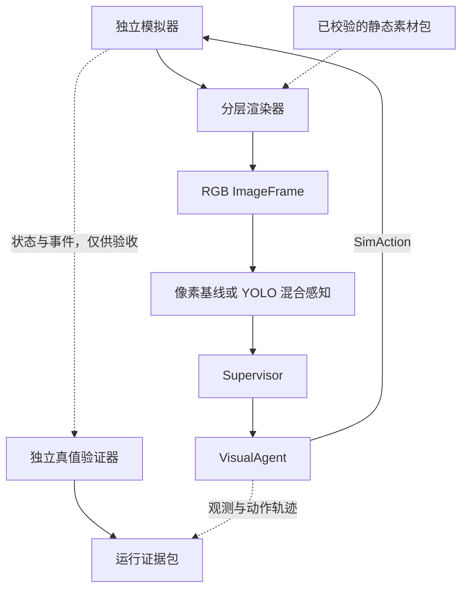

# Maple Vision Platform 最终实施方案

**用途：交给另一名程序员或编程 AI，即可复现当前实现，并继续完成剩余工程。** 本文统筹 [v8 总规格](../MASTER_SPEC.md)、[实际架构](ARCHITECTURE.md)、[v0.1 历史验收](RELEASE_ACCEPTANCE.md) 与当前 **v0.2.0 发布候选**。本轮执行顺序和门禁见 [V0_2_PLAN.md](V0_2_PLAN.md)，准确提交的最终结果见 [v0.2 发布验收](RELEASE_0_2_ACCEPTANCE.md)。旧版本验收、新实现可运行、当前版本发布通过、完整 v8 完成是不同状态。

## 1. 交付目标与当前结论

建立一个本机可运行的闭环：有来源的知识与素材进入独立模拟世界；渲染生成图像，视觉模块理解图像，策略决定动作，模拟器执行动作，独立验证器核查结果。使用者能自己复现成功和失败，不需要拿正式账号试错。

当前具备 SQLite 知识目录、静态素材登记与渲染、会话级合成数据集、实际 YOLO 训练和 ONNX 推理、三职业两地图任务、故障测试、动作重放、录像观察与本地 OCR。v0.2 增加本地知识增量计划、生命周期数据与分组评估、指定模型的 suite/soak、资源采样和真实感知/策略重新执行。当前修改的完整测试、跨平台 CI、新验证器最终门禁和候选模型推广仍待验收；内置规则与画面仍为 `synthetic_fixture`，没有将小册子最新资料、正式地图物理或真实图像效果冒充为已核实内容。

本项目执行对象是独立 Python 模拟器。正式客户端控制、系统按键注入、输入伪装、封包/内存修改和反作弊绕过不在交付范围内；独立验证也不能证明正式账号不会被封。玩家回复只产出待人工确认的本地草稿。依赖安装后，默认运行、训练、推理和 OCR 使用本地计算，不调用 LLM API，不消耗运行时 LLM token；编程 AI 开发本身的计费另算。

## 2. 总体架构与信息边界



知识目录向模拟器和策略提供**同版本静态职业参数**；它不能向策略泄露玩家位置、怪物血量或其他动态真值。训练支路可以从模拟器状态生成正确标签，运行支路不能读取这些标签。当前隔离由接口、依赖方向和测试约束实现，并非进程权限沙箱。

核心接口已经存在：

| 边界 | 当前合同 |
|---|---|
| 模拟器 | `Simulator.step(SimAction) -> StepOutcome`；固定时间步、可保存恢复 |
| 图像 | `ImageFrame(sequence, timestamp_ms, width, height, pixels)`；只含 RGB bytes 与帧身份 |
| 对象检测 | `Detector.detect(frame) -> tuple[Detection, ...]`；框为原图 xyxy |
| 感知 | `observe(frame) -> VisualObservation`；对象、HP/MP、地图、对话可见性及来源 |
| 监督与策略 | `Supervisor.inspect(observation, now_ms)`；`VisualAgent.decide(observation)` |
| 独立验证 | 可读模拟器 snapshot；核验目标完成、状态与采样画面，不能反馈隐藏答案给策略 |

`VisualObservation` 明确区分已知与未知；没有测量依据的字段保持 `None`，置信度不是天然校准概率。原 P0 的 opaque `Frame`、NoOp `Pipeline`、v1 数据库接口保留兼容，不能将其占位合同误当成当前 RGB 链路。字段与签名以 [API_CONTRACTS.md](API_CONTRACTS.md) 为准。

## 3. 知识底座：先离线固化，再做可追溯更新

职业、技能、怪物、掉落关系、地图、道具、NPC、任务等相对稳定资料，应从**允许使用的小册子导出或其他已获准来源**预先整理。候选参考来源为 [冒险岛小册子](https://mxdc.dvg.cn/)；当前仓库没有已经采集好的最新国服数据库，也没有自动网络同步器。

现有落地流程是：本地 JSON 导出 → 严格校验 → SQLite v2 事务导入 → 冲突检查 → 只读查询/快照。每条记录绑定实体 ID、游戏版本、源 URI、采集时间、许可说明、scope、核实状态、payload 及内容哈希。同版本矛盾候选全部保留为 `CONFLICTED`；`UNKNOWN`、`PROVISIONAL` 不自动升级。默认只查询 `VERIFIED`，版本不匹配或无数据时明确缺失，不用猜测填空。[目录格式](CATALOG.md)

当前只有三个已支持职业的完整 `ClassSpec` 真正接入运行：必须同版本、全部 VERIFIED、无冲突且属于 `synthetic_fixture`。12 个字段覆盖资源上限、基础伤害/距离/消耗/冷却、弹药、跳标、治疗、移动和跳跃速度。运行包保存参数与来源哈希，删除原数据库后仍能重放。地图、怪物、通用 Buff/药品等条目目前不会自动改变规则。[职业注入](CLASS_PROFILES.md)

**v0.2 已实现本地增量计划：** `LocalExportSource` 按现有严格导出格式捕获原字节，`knowledge plan-sync` 保存源哈希、来源/版本、完整目录基线和 added/unchanged/changed/missing 差异。`apply-sync` 重算计划，并在同一 `BEGIN IMMEDIATE` 事务中检查基线、导入和预期结果；过期或篡改计划失败，完整预期结果已经存在时显式幂等。missing 仅表示旧证据未出现在这次导出中，不删除历史、不解除冲突、不自动核实。计划哈希不是签名或批准凭据。[增量合同](KNOWLEDGE_SYNC.md)

**后续仍未实现：** 网络来源适配器、最新小册子数据、持续调度与其余知识类型的规则映射。新计划应用成功也不会自动热替换任务规则；需要新建、核验并显式选择运行快照。“页面能打开”与“资料可以使用”需要分别确认。

## 4. 素材、地图与场景管线

现有 `Asset Registry` 接收本地单帧 PNG/JPEG/WEBP，验证解码后按内容哈希保存原文件，同时记录来源与授权说明。`SpritePack` 将七个检测类别中的一个或多个映射到已登记的 asset ID，可同时用于 `dataset create` 与 `lab run`。RGBA 图按实体框缩放；透明度同时影响真实渲染和可见实例标签。运行包复制素材与 pack 元数据，回放不再依赖原注册表。[素材接入](SPRITE_PACK.md)

地图已经分离背景/视差、装饰、平台/梯子、动态对象和 HUD；默认画布 320×192，支持较窄视口的镜头变换。当前仅有自绘 `meadow`、`cavern`，实体碰撞几何与图片外观分离。更换图片不会自动导入新碰撞结构、动画、技能规则或地图。

**后续提案：** 外部地图包由版本化 manifest、geometry、layers、portals、validation 组成，校验坐标系、平台可达性、门的目的地和素材引用；动画包另外声明状态、帧、时长及锚点。先实现加载器与错误拒绝，再做编辑器。MapleNecrocer 等工具仅为待评估候选，许可、输入兼容性与输出质量均未验收。静态图片接入不等同于该地图/动画管线已经完成。

## 5. 数据集、YOLO 与视觉状态

### 5.1 数据制作

`dataset.py` 从多种子模拟会话生成 RGB 图片与可见框，类别为 player、monster、loot、portal、npc、platform、ladder。框裁剪到画面；被遮挡而不可见的实例不凭真值强行标出。train/val/test 按完整会话分开，manifest 记录种子、会话、类别、图片/标签及 `data.yaml` 哈希。校验拒绝越界标签、跨分区重复图片、遗漏文件、未登记文件和路径逃逸。[视觉实现](VISION_IMPLEMENTATION.md)

v0.1 的 288 帧数据缺少 x<40 的玩家样本，而模拟器起点 x=24。v0.2 的显式 `profile="lifecycle"` 新增 schema v2：用实际模拟动作走完两图战斗、收集、对话和往返，选取出生、战斗、拾取、清场、对话、切图六阶段及边缘、高台、非落地位置。校验器逐会话重放动作，独立核对所选画面、可见标签、阶段和覆盖统计；训练生成可读取真值，运行检测器仍只接收 RGB 帧。默认 legacy 生成器和旧数据字节保持兼容。[生命周期合同](DATASET_LIFECYCLE.md)

本轮冻结输入为 18 会话×48 帧，共 864 张图片、7098 个可见标注，train/val/test 为 480/192/192 帧；manifest SHA-256 为 `670f6dae181f0f4b3107ba6a47cb733f19cfbc216c4e8e8c23f96b756601b3ff`。三职业、两地图、六阶段及五种位置分组均有覆盖。分组评估重新计算每组 TP/FP/FN/AP，保留聚合结果；无怪物真值时的误检仍计 FP。两张地图仍在各分区出现，会话隔离和生命周期覆盖不等于未见地图或真实域泛化。

### 5.2 训练与推理职责

YOLO 是学习图像中对象位置和类别的检测模型；它不负责理解技能规则或完成任务。当前 tiny 结构从本地 YAML 随机初始化，CPU 训练，单独导出 ONNX，再由真实 ONNX Runtime 推理。训练使用私有数据副本，第三方缓存不会污染源数据集；模型 manifest 绑定权重哈希、类别顺序、输入尺寸、输出格式与适用域。

默认 `PixelPerception` 是几何样例专用颜色基线。模型闭环明确使用 **YOLO 检测玩家/怪物/掉落/NPC/门，像素方法读取平台/梯子/HUD/地图/对话标记**；动态对象漏检时不偷偷用颜色基线补成 YOLO 成绩。自定义素材必须训练或提供适配检测器，不能期待原调色板解析器自动识别。

v0.2 让同一个显式 ONNX 实例进入 suite/soak，并在新运行包中记录实际加载模型哈希、manifest、阈值和终止观测。`lab reinfer` 从初始画面起实际执行每帧感知、监督和策略，比较新计算的观测与动作；它不把记录动作当作新策略输出。预检资源/文件变化边界和原始失败轮次保留仍须完成最终门禁，详见 [模型验证](MODEL_VALIDATION.md)。

本地 Tesseract 适配器可以识别指定图像区域文字，但尚无游戏中文小字、聊天栏或真实 HUD 准确率验收，也没有自动接入任务策略。完整时序跟踪、目标身份、WorldState/BeliefState 融合属于后续工程：需保留测量时间、来源、有效期和不确定性，不能把上次估计永久当真。[训练](TRAINING.md) · [评估定义](EVALUATION.md) · [录像与 OCR](RECORDINGS.md)

### 5.3 v0.1 模型历史结果与 v0.2 选模边界

v0.1 的最终候选为 320px、60 epoch，按验证集选择后才评估当时的保留 test。该历史测试集为 64 帧、633 个目标，在 confidence≥0.25、IoU=0.5 下为 TP=535、FP=0、FN=98；micro precision=1.0000、recall=0.8452、macro AP50=0.92645。平台召回约 **0.4948**。这里的 AP50 是置信度截断后的单 IoU 指标，不是完整 COCO mAP50–95。

混合感知下，标飞/龙骑/牧师分别用 327/349/317 步完成两图任务并通过独立重放，标飞包含两次跳跃攻击。三次合成任务成功不足以证明总体可靠率或真实素材泛化。模型、分区和完整指标见 [YOLO_EXPERIMENT.md](YOLO_EXPERIMENT.md)；随仓库模型位于 `examples/fixture-model/`。

在 v0.2 新数据的 **192 帧 val** 上，同一旧模型的 AP50 为 **0.900697**、平台召回为 **0.467014**。这是用于本轮选模的同数据基线；不能与上面的旧 test 数字直接比较并推断升级效果。新候选训练、验证集选模、选择后的 test 和闭环验收由独立实验记录负责，尚未授予新模型推广结论。准确结果汇入 [v0.2 发布验收](RELEASE_0_2_ACCEPTANCE.md)。

## 6. 职业能力、任务与有界监督

| 范围 | 当前实现 | 扩展要求 |
|---|---|---|
| 标飞 `assassin` | 远程基础攻击、弹药消耗、跳标组合 | 新技能必须定义前置条件、消耗、冷却与可见效果 |
| 龙骑 `dragon_knight` | 近战与范围技能差异 | 攻击区域、命中与多个目标独立测试 |
| 牧师 `cleric` | MP 差异与自我治疗 | 治疗量、MP 不足和动作拒绝测试 |
| 通用动作 | 移动、单段跳跃、梯子、拾取、HP/MP 药品、Buff、NPC 对话、传送门 | 新动作须同时有执行合同和验证方法 |
| 任务 | 两图战斗→收集→NPC 对话→旅行的有限状态机 | 通用任务 DSL、可配置任务图尚未实现 |
| 玩家回话 | `chat-draft` 封装用户提供的回复，`sent=false` | 自动理解、LLM 生成与发送后端均未实现 |

职业不等于一组按键脚本。新增职业要显式描述能力并验证模拟行为；当前三个 job ID 之外没有外部职业插件加载器。后续职业包可以提出数据 Schema，但在加载器、版本迁移与回归完成前不能称为现有 API。[模拟器行为](SIMULATOR_IMPLEMENTATION.md)

模拟器默认固定 50ms 时间步和随机种子，状态保存包含确定性恢复所需信息。策略根据画面血蓝与对象关系处理生存、资源、战斗和任务进度；动态库存并没有通过隐藏真值或完整 OCR 输入策略。执行回执 `accepted` 只表示动作被接受，可见目标消失也不能单独证明击杀或拾取归属。

Supervisor 默认检查 250ms 新鲜度、帧序号/时间与资源可读性，连续未知预算为 12 步；策略有卡住恢复和战斗进度预算，episode 默认最多 1000 步。短暂故障允许恢复，持续未知停止，无法恢复的输入冻结有界失败。独立 oracle 最后核验两图清理、实际掉落收集、NPC 对话和存活；策略自称完成而 oracle 不通过必须记失败。

## 7. 录像、重放与运行证据

四种证据要分别使用：

| 模式 | 可以验证什么 | 不能由此证明什么 |
|---|---|---|
| 本地 PNG/MP4 导入与观察 | 文件/像素完整性、帧序、已有画面的感知输出 | 无标注就没有准确率；固定录像不能响应新动作 |
| `lab replay` | 从初始状态重放实际动作，复核状态、事件、采样像素与任务结果 | 不重新运行原模型，明确 `perception_reproduced=false` |
| `lab reinfer` | 新版运行包中实际重新执行感知、监督与策略；比较完整观测、决策与终止状态 | 需要同一模型身份和阈值；旧包缺少证据时拒绝；复现失败任务不等于任务成功 |
| 模拟器交互闭环 | 执行动作后产生新状态，再观察并验证效果 | 自建规则不会自动证明正式规则或账号安全 |

每次输出新目录，保存 summary、完整 trace JSONL、初末状态、采样 PNG、最终画面、预览与文件 manifest。可选职业参数和素材随包保存；记录模型/数据哈希、配置、种子与运行版本。哈希检测内容变化，不是来源真实性的签名。MP4 当前时间戳按名义 FPS 估算，不是精确逐帧 PTS，不能用来推断毫秒级技能时序。[数据格式](DATA_SCHEMAS.md)

## 8. 从零复现：实际可执行命令

以下在仓库根目录使用 Python 3.12；所有实验输出路径必须是新路径。Linux 初始化：

```bash
python3.12 -m venv .venv
source .venv/bin/activate
python -m pip install -r requirements-dev.txt
python -m pip install --no-build-isolation --no-deps -e .
python -m pip check
```

Windows 用 `py -3.12 -m venv .venv` 创建环境，后续将 `python` 替换为 `.\.venv\Scripts\python.exe`，无需修改系统执行策略。平台差异与完整安装说明见 [QUICKSTART.md](QUICKSTART.md)。

### 8.1 先验证工程闭环

```bash
python -m maple_vision lab run --output artifacts/plan-assassin --job assassin --seed 0
python -m maple_vision lab replay artifacts/plan-assassin
python -m maple_vision lab run --output artifacts/plan-knight --job dragon_knight --seed 1
python -m maple_vision lab run --output artifacts/plan-cleric --job cleric --seed 2
python -m maple_vision lab suite --output artifacts/plan-suite --seeds 3
python -m maple_vision lab run --output artifacts/plan-yolo --model examples/fixture-model/model.onnx --manifest examples/fixture-model/manifest.json
python -m maple_vision lab replay artifacts/plan-yolo
```

前五条使用像素基线；模型命令使用混合感知。正常 episode 要同时检查 `status=completed` 和 `independent_goal_check`。CLI 正常返回 0，明确失败/停止返回 1，参数或文件校验错误返回 2；故障套件按预期停止也可算测试通过。

### 8.2 导入静态知识与素材

上述运行会创建 `artifacts`；若单独从此节开始，先创建该父目录。

```bash
python -m maple_vision knowledge init artifacts/plan-knowledge.sqlite
python -m maple_vision knowledge plan-sync artifacts/plan-knowledge.sqlite fixtures/knowledge-demo.json artifacts/plan-knowledge-sync.json
python -m maple_vision knowledge apply-sync artifacts/plan-knowledge.sqlite artifacts/plan-knowledge-sync.json
python -m maple_vision knowledge query artifacts/plan-knowledge.sqlite classes assassin fixture-v1
python -m maple_vision knowledge snapshot artifacts/plan-knowledge.sqlite artifacts/plan-snapshot
python -m maple_vision knowledge verify-snapshot artifacts/plan-snapshot
python -m maple_vision lab run --output artifacts/plan-profile --knowledge-db artifacts/plan-knowledge.sqlite --game-version fixture-v1
```

`knowledge-demo.json` 是合成测试资料。先查看计划中捕获的证据与差异，再应用；原来的 `knowledge import` 仍可用于直接原子导入。素材须先准备自己创作或获准使用的本地图片；登记命令、映射 JSON 和实际授权字段见 [SPRITE_PACK.md](SPRITE_PACK.md)。随后对 `dataset create` 与 `lab run` 成对增加 `--asset-registry REGISTRY --sprite-map MAPPING.json`。替换素材后应重训检测器并重新验收，现有模型没有任意画风兼容承诺。

### 8.3 生成、训练、导出与独立评估

```bash
python -m maple_vision dataset create artifacts/plan-data --profile lifecycle --sessions 18 --frames 48 --seed 20261125
python -m maple_vision dataset check artifacts/plan-data
python -m maple_vision vision benchmark artifacts/plan-data --output artifacts/plan-pixel-val.json --split val
```

真正训练前安装固定的可选训练环境；安装需要网络，训练消费本地数据：

```bash
python -m pip install --no-deps --index-url https://download.pytorch.org/whl/cpu torch==2.15.0+cpu torchvision==0.29.2+cpu
python -m pip install -r requirements-training.txt
python -m pip check
python -m maple_vision model train artifacts/plan-data --output artifacts/plan-train --epochs 40 --image-size 320 --batch 8 --seed 42
python -m maple_vision model export artifacts/plan-train/run/weights/best.pt --output artifacts/plan-export --image-size 320
python -m maple_vision vision benchmark artifacts/plan-data --output artifacts/plan-yolo-val.json --split val --model artifacts/plan-export/model.onnx --manifest artifacts/plan-export/manifest.json
```

以上是 v0.2 首个候选的 320px、40 epoch、batch 8、seed 42 计划，不是已经取得的成绩；实际候选与结果以实验记录为准。v0.1 历史实验使用旧版数据，复现时应采用其原数据命令。3 epoch 可用于流程 smoke，不能作为质量验收。Python API 与 CLI 的默认输入尺寸不同，实验命令始终显式指定。调参只看 train/val，test 作为选择后的保留评估；持续据 test 修模型后必须建立新的独立留出集。

固定候选权重与选模理由后，再执行保留 test 和独立任务检查：

```bash
python -m maple_vision vision benchmark artifacts/plan-data --output artifacts/plan-yolo-test.json --split test --model artifacts/plan-export/model.onnx --manifest artifacts/plan-export/manifest.json
python -m maple_vision lab run --output artifacts/plan-new-model --model artifacts/plan-export/model.onnx --manifest artifacts/plan-export/manifest.json
```

新运行包可用同一模型做实际重新推理，再把该模型显式用于矩阵与短时长稳：

```bash
python -m maple_vision lab reinfer artifacts/plan-new-model --model artifacts/plan-export/model.onnx --manifest artifacts/plan-export/manifest.json
python -m maple_vision lab suite --output artifacts/plan-model-suite --seeds 3 --model artifacts/plan-export/model.onnx --manifest artifacts/plan-export/manifest.json
python -m maple_vision lab soak --output artifacts/plan-model-soak --seconds 60 --resource-interval 1 --max-resource-samples 1024 --model artifacts/plan-export/model.onnx --manifest artifacts/plan-export/manifest.json
```

输出包括实际墙钟、进程 CPU 和支持平台上的 RSS 来源与单位；未知内存保持 `null`。资源样本有界保留，最大采样值不能冒充精确瞬时峰值。最终预检/文件变化防护和原始失败包保留须随本版准确提交验收。

### 8.4 本地录像、OCR 与草稿

准备有权分析的 `./recording-frames` PNG 目录，文件名补零，下面授权说明应替换为真实情况：

```bash
python -m maple_vision recording import ./recording-frames artifacts/plan-recording --source-uri urn:my-recording:session-001 --permission explicit_permission --license "Owner-provided recording; local analysis permitted" --fps 20
python -m maple_vision recording check artifacts/plan-recording
python -m maple_vision recording observe artifacts/plan-recording --output artifacts/plan-observations
python -m maple_vision vision ocr artifacts/plan-recording/frames/000000.png --language eng
python -m maple_vision chat-draft --incoming "现在有空吗？" --reply "稍等，我忙完回复你。"
```

OCR 需要本机 Tesseract 与对应语言包；中文需自行安装并验证 `chi_sim`，程序不自动下载。MP4 还需要可选 OpenCV/FFmpeg。录像感知可成对提供 `--model --manifest`，但这些检测框不会自动补全真实地图与血蓝状态。

## 9. P0–P13 工作拆解与依赖

按此表继续现有仓库，不重建已经通过的基础设施。实际机器可并行处理独立模块；集成前先冻结合同。机器可读依赖见 [milestones.yaml](../engineering/milestones.yaml)。

| 阶段 | 前置 | 当前实现（v0.2 新增仍待最终门禁） | 完整目标仍需的工作 |
|---|---|---|---|
| P0 工程基础 | 无 | 合同、CLI、v1 SQLite、CI 与兼容回归 | 保留历史验收，不改写旧成绩 |
| P1 知识 | P0 | v2 导入/冲突/快照、职业配置注入、本地增量计划与原子应用 | 网络来源与持续调度、最新核实数据、其余规则映射 |
| P2 素材 | P0 | 注册、校验、静态 SpritePack | 授权真实资源、动画与锚点 |
| P3 地图渲染 | P1/P2 | 两地图、分层/镜头/透明度标签 | 外部地图包、编辑与几何校验 |
| P4 数据 | P3 | legacy v1、生命周期 v2、动作/像素/标签/覆盖重放检查 | 未见地图、真实标注、更多遮挡与跨域覆盖 |
| P5 模拟器 | P0/P3 | 固定步长、物理/战斗/资源/保存恢复 | 更多机制、经核实的规则校准 |
| P6 模型 | P4 | 训练、导出、ONNX、聚合与生命周期分组指标 | 本轮候选最终选模、模型规模/两阶段比较、真实域准入 |
| P7 视觉状态 | P5/P6 | 对象、样例 HUD、本地 OCR | 时序追踪、真实 UI、BeliefState |
| P8 职业 | P1/P5 | 三职业与严格参数注入 | 全职业数据、外部能力包 |
| P9 任务 | P7/P8 | 两图任务、视觉效果与真值核验 | 通用任务 DSL、配置化任务图 |
| P10 监督 | P9 | 新鲜度、未知/恢复预算、失败停止 | 更丰富故障与恢复证据 |
| P11 回归 | P10 | 动作重放、故障集、录像观察、新版实际模型/策略重新执行 | 新验证器最终门禁、真实 Golden Recording |
| P12 扩展 | P11 | 三职业两地图组合 | 第三方内容包、管理 UI |
| P13 发布 | P12 | wheel/CI、指定模型的 suite/soak、进程资源测量 | v0.2 准确提交 CI、完整 24 小时墙钟和真实域发布门禁 |

每项交给编程 AI 时，任务单写清：输入版本、允许修改的文件、当前接口、预期行为、独立失败案例、验收命令和证据位置。先补能暴露问题的案例，再实现和审查；修复尝试有预算，失败保留最小复现，不降低断言掩盖问题。新增格式必须有版本和迁移，不能修改旧证据使其“适配”新实现。

## 10. 验收标准与发布证据

工程验收按顺序进行：单元/边界测试 → 跨模块闭环 → 可重复动作重放 → 故障注入 → 隔离安装 → 原生训练/推理 → 准确提交的跨平台 CI。需要比较算法时使用独立期望值、差异测试和反例；不要用读取同一隐藏状态的两个函数互相证明正确。

```bash
python -m ruff format --check .
python -m ruff check .
python -m mypy
python -m pytest -q
python -m build --wheel --no-isolation
python scripts/wheel_smoke.py --wheel dist/maple_vision_platform-0.2.0-py3-none-any.whl
python -m maple_vision lab soak --output artifacts/plan-soak --seconds 60
```

训练环境另执行 `MAPLE_TRAINING_SMOKE=1 python -m pytest tests/test_training.py -q`；Windows 环境变量写法见快速开始。完整长稳请求使用 `lab soak --output artifacts/plan-soak-24h --seconds 86400`，需持续运行并核对实际墙钟结果；该长时任务不是上面命令的隐含步骤。

下面保留 v0.1 的历史结果；这些数字不代表当前 v0.2 工作树已通过。v0.2 的完整测试、模型门禁、安装与远端 CI 统一记入 [RELEASE_0_2_ACCEPTANCE.md](RELEASE_0_2_ACCEPTANCE.md)。

| 验收层 | v0.1 历史结论 | v0.2 与后续证据要求 |
|---|---|---|
| 平台工程 | 本地 500 passed/1 skipped；原生联合 107 passed，存在重叠不能相加 | 精确提交、依赖、环境、命令、失败与跳过原因 |
| fixture 任务 | 基线 9 个正常任务和 4 个预期故障结果通过；选定模型混合闭环另报 | 更多种子、地图与任务阶段；模型和基线分别统计 |
| 模型质量 | 有上述 test 指标与明确平台短板 | 分类别、遮挡/小目标、会话置信区间、延迟及域外失效 |
| 真实域 | 未验收 | 获准素材、已核实规则、独立真实录像与人工标注 |
| 24 小时 | 未完成；已有 60.488 秒短时 smoke | 实际墙钟≥86400 秒、固定机器/版本、失败和资源趋势 |

实现提交 [`2114372ac4705625b017d0dc907168560e768db2`](https://github.com/www1350/maple-vision-platform/commit/2114372ac4705625b017d0dc907168560e768db2) 的 [GitHub Actions 45380643809](https://github.com/www1350/maple-vision-platform/actions/runs/45380643809) 三个作业已通过：Ubuntu 498 passed/3 skipped，Windows 495 passed/6 skipped，原生训练/录像/OCR 107 passed/0 skipped。不同环境跳过项不能计作通过；此成绩只覆盖该实现提交，后续最终 PR 提交仍需自己的检查。

v8 中地图识别 99%、平台定位 98%、核心任务 98%、拾取 95%、生存 99%、恢复 95% 是**建议目标**，不是当前实测成绩。实施前须定义分母、任务分布、样本量和不确定性；检测 AP 不能替代任务成功率。当前门禁见 [v02-contract.yaml](../engineering/v02-contract.yaml)；[platform-contract.yaml](../engineering/platform-contract.yaml) 与 [RELEASE_ACCEPTANCE.md](RELEASE_ACCEPTANCE.md) 保留 v0.1 归档状态。

## 11. 下一轮工程的明确优先级

1. **完成 v0.2 模型与发布验收。** 生命周期 v2 数据已冻结，保留旧实验；根据新数据的 val 选择候选，再做保留 test、逐阶段/位置漏检分析和三职业两图闭环。准确提交的测试与 CI 通过前保持候选状态，未达到模型门禁则保留实验失败。
2. **扩展经授权的知识闭环。** 本地静态导出的计划/应用已实现；后续为获准来源增加网络适配和持续调度，完成真实资料映射审查，再把地图/怪物/技能规则逐项接入。不把目录条目存在当作玩法已经生效。
3. **扩展外部内容。** 在现有静态 SpritePack 上添加动画/锚点和地图包验证；用全新内容包测试加载、碰撞、可见标签及旧版本重放，之后再扩展职业。
4. **建设真实录像评估集。** 按独立录制会话和地图留出，人工标注对象、HUD 和文字；记录画面尺度、遮挡与版本，真实域误差单独报告。需要精确时序时先补逐帧 PTS 合同。
5. **补状态与任务通用性。** 设计有期限的跟踪/BeliefState 和可配置任务图；利用本轮新增的实际模型/策略重新执行做回归，但先完成其预检与文件变化边界验收。新提案先过 Schema 与独立测试，再接现有 VisualAgent，最后考虑管理 UI。
6. **执行发布长稳。** 本轮已接线显式模型与有界资源测量；待其最终门禁通过后，固定提交、依赖、数据/模型和机器，真正连续运行 24 小时。应保留实际失败轮次一次，而非重新运行制造替代证据；这项最终行为仍待 v0.2 验收确认。短时 smoke、模型长稳入口存在、完整 24 小时通过分别记录。

继续开发的入口是本文件与 [IMPLEMENTATION_PLAN.md](IMPLEMENTATION_PLAN.md)；实现细节查 [API_CONTRACTS.md](API_CONTRACTS.md)、[DATA_SCHEMAS.md](DATA_SCHEMAS.md) 和各专题文档。每次交付都同时给出代码、可执行命令、实际证据与未通过项，使下一名执行者能直接复现，而不是重新推测项目状态。
