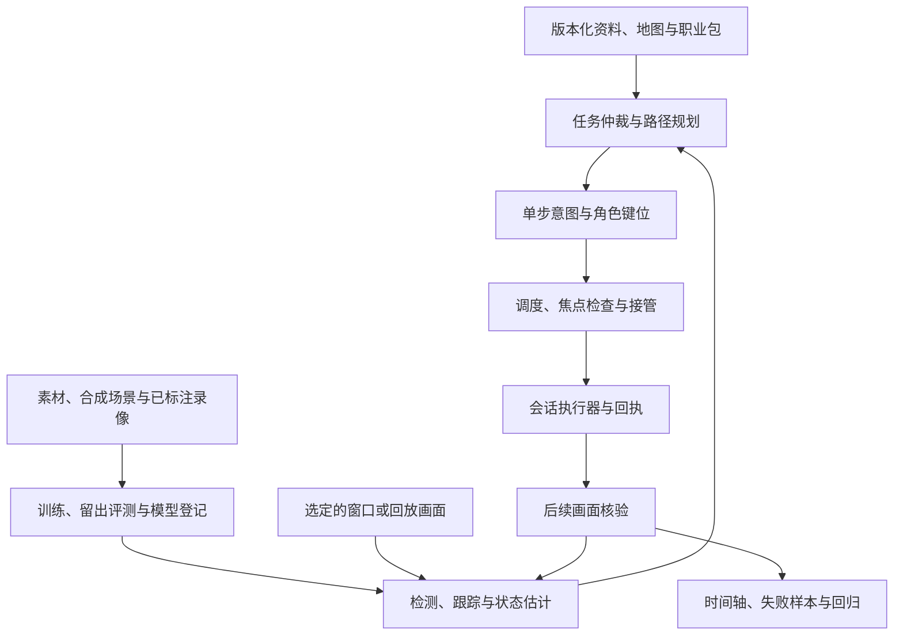

# Maple Vision Platform 完整技术方案
**国服怀旧服 · 2026 年 11 月 26 日修订**

**最终交付**　在玩家自己的 Windows 电脑上，玩家手动登录、选角色、确认键位并启动任务。平台在获准的真实游戏窗口观察画面、操作角色、核对效果。玩家随时可以接管。第一个可验收的任务是无影人在死亡之林Ⅰ和Ⅱ接绳、换层、选敌，用双飞斩打怪并复核结果。

最早的《国服说明》讨论的是标飞怎样看画面、走位、打怪和从故障中恢复。后来归档的 v8 总纲在第 15、21 章把正式游戏写成只读，开发随之集中在模拟器和录像。此次修订恢复真实窗口这个产品终点。v8 的 22 章继续定义工程范围，保留原始规格和历史成绩。本文统一说明研发如何走到玩家可用、每项证据能证明什么。[最早的产品讨论](https://chatgpt.com/share/6b0797bb-3d64-83e8-b654-51fb61f9e441?ogimg=plain) · [原始 v8 总纲](https://github.com/www1350/maple-vision-platform/blob/main/MASTER_SPEC.md) · [历次实现与缺口](https://github.com/www1350/maple-vision-platform/blob/main/docs/PLAN_ALIGNMENT.md)

## 一、玩家看到的完整流程

1. **选窗口与角色。** 玩家自行登录并选角。工作台显示区服、客户端版本、目标窗口、角色档案、分辨率和可用执行方式。账号密码由玩家在客户端自行处理。每个会话绑定一个窗口和一份角色档案。
2. **确认自己的键位。** 玩家打开游戏键位设置，工作台标出技能图标与物理键，列出走、跳、拾取、交互、药品和职业技能。低置信度或冲突的格子高亮供纠正；同一物理键重复出现时合并显示。保存后可按角色复用，布局、角色或关键版本变化时再确认。双飞斩只有一个技能绑定，地面和空中都用它。
3. **选任务，预览，再开始。** 以死亡之林双图为例，预览显示自己在哪层、绳索与候选怪物在哪、平台准备做什么。玩家能设置停止条件。若当前环境只有观察权限，界面明确显示可执行的操作范围。
4. **让它做，随时接过来。** 运行页叠加当前目标、意图及最近一次效果。失焦、手动接管或窗口身份变化会中止派发，释放会话持有的键。重新获取焦点后，须由玩家明确恢复。
5. **用回放验收。** 时间轴支持点开任一次接绳或出手，查看决定前画面、角色键位、实际派发、后续帧与结果。把一次落空或错误换层导出为失败样例。原始录像默认本地留存，分享前可遮盖名字和聊天。

## 二、系统架构与技术选型

单机模块化。Windows 本机负责画面采集和窗口会话，Python 3.12 承载运行逻辑，SQLite 保存静态知识与索引。FastAPI 与本地网页提供工作台。动态检测采用 YOLO、ONNX Runtime，固定界面用 OpenCV，文字按需走本地 OCR。实时决策采用任务仲裁、图搜索和状态机，运行期间 LLM 调用目标为零。开发、标注辅助和离线分析与实时循环各自运行。

| 模块 | 输入、输出与核心约束 |
|---|---|
| 知识、素材与版本 | 经允许获取的小册子或手工导出、素材和参考录像进入来源档案。将职业、技能等级、武器、攻速、怪物、掉落、药品、NPC、任务及地图连接写入带版本的 SQLite 快照。素材保留 ID、哈希、许可与用途。资料冲突并列，待实测解决。对局只读本地快照。 |
| 地图、渲染与训练 | 地图包分别描述平台、绳索、传送点、镜头和背景图层。模拟器提供独立物理、技能、资源和确定性重放。场景工厂按地图、动画、遮挡生成训练样本；真实录像按会话划分训练、验证与留出测试，避免相邻帧泄漏。地图导出工具的兼容性和素材授权独立核对。 |
| 模型与感知 | 比较通用检测、全怪物分类、检测后再分类以及不同模型规模。登记数据与模型哈希，按小目标、遮挡、未见地图评估召回、误检和延迟。运行时分别识别自己、怪物、掉落、绳索、平台、小地图、HP/MP 和可读 UI。已有混合 ONNX 有限定场景基线；新候选按冻结的验证门槛决定是否启用。 |
| 多帧状态与导航 | 跟踪同一目标，按时间、来源、置信度和有效期更新角色朝向、所处平台、姿态、怪物、资源与界面状态。世界图规划跨图路线，平台图规划走、单段跳、落地和攀爬。镜头移动后重新定位。角色本领由职业包声明，地图包提供地形。 |
| 职业、任务与动作 | 职业包给出技能适用姿态、方向、范围、资源和动作阶段。任务引擎负责生存、战斗、Buff、拾取、导航、切图、背包、交互、恢复和等待；聊天回复需玩家确认。规划器每次提交一个带前置条件、截止时间和资源占用的意图。生存与人工接管可抢占后续步骤。 |
| 执行、监督与验证 | 调度器消解动作冲突，按会话类型选择模拟、自有窗口或获准客户端的输入途径；录像只观察。执行前复核窗口、焦点、档案与最新观测，记录按下、释放及取消。监督器处置遮挡、卡帧、丢失目标、地图未知、断线、卡住与资源不足，有限重试后转人工。 |
| 回放、工程与发布 | 记录来源帧、推理版本、任务、意图、输入回执、效果、恢复和终止原因。可分别重放动作和从画面重跑推理。每个故障追加回归样例。开发以 Git、pytest、Ruff、mypy、跨平台 CI、安装包验证及最终提交复核为基础，发布支持矩阵随版本更新。 |

五项长期复用资产是游戏知识库、素材索引、数据集工厂、模拟器、独立验证平台。模拟器真值只供独立评测，视觉决策只能看到当前输入源能观察到的信息。新增地图主要新增地图包与样本，新增职业主要新增能力包、角色键位和对应测试。[运行合同](https://github.com/www1350/maple-vision-platform/blob/main/docs/TASK_RUNTIME.md) · [职业包](https://github.com/www1350/maple-vision-platform/blob/main/docs/CLASS_PACKAGES.md) · [任务配置](https://github.com/www1350/maple-vision-platform/blob/main/docs/MISSION_PROGRAMS.md)

## 三、第一条路线怎样打通

以“无影人从死亡之林Ⅰ开始，换层找到怪，用双飞斩攻击，再进Ⅱ继续”为首个用户验收。第一轮支持单段跳；地图、镜头和怪物分布都以各图真实样本校准。玩家可以仅在某一步失败时打开回放，判断错在识别、决策还是操作。

| 步骤 | 平台按什么做决定 | 玩家怎样核对 |
|---|---|---|
| 定位与接绳 | 认出角色、当前平台和目标绳索，规划可达接近点。对齐后尝试攀爬。 | 回放标出接近过程。用连续画面的角色与绳索相对位置、持续纵向位移确认接绳。 |
| 换层与选敌 | 到达后确认角色离绳、站到指定平台，重新检测同层或可达位置的目标。比较朝向、横纵距离、姿态和同屏遮挡。 | 新平台与目标各有来源帧。遮挡或多人重叠时记录不确定；看不清时取消出手、重观察。 |
| 地面或空中出手 | 地面满足条件时施放一次。跳标先跳，再由画面确认腾空、目标仍在窗口内，使用同一个双飞斩键。冷却、资源或目标条件变化会取消后续步骤。 | 并排查看技能绑定、输入回执、起手帧和后续伤害。录像可见动作、目标归属、段数和资源消耗分别判定。 |
| 击杀、拾取与换图 | 结合目标跟踪、可归属伤害、掉落和背包变化评估结果；到传送点后用新地图身份与重新定位确认切换。 | 短时消失的怪物保留“未知”。地图Ⅱ要有自己的完成与失败记录。 |

**真实双飞斩的标定。** 用连续实录记录版本、角色、技能等级、装备、朝向、地面或空中、UI 缩放。标注起手、首次及末次反馈、落地或可再次行动时间。按方向、姿态与距离分别收集命中和落空，得到带样本数的范围边界。玩家确认的技能键单独保存。确认耗镖须在可排除其他消耗的区间读取前后库存；伤害数字和按键回执不能代替库存读数。

**第二个职业用龙骑士验证扩展能力。** 国服资料把 Lv30 枪连击列为每段 170%、三段、最多三目标、24 MP，表列宽高 134 × 70。单位换算、人物原点、受击框和攻速会影响实际表现。采集同技能等级、枪类武器和攻速的命中、边缘落空与多目标实录，逐段测起手、命中间隔和恢复。当前合成职业包已经能表达三段、最多三目标；实测参数通过校准后才能进入国服职业包。[国服枪连击资料与校准记录](https://github.com/www1350/maple-vision-platform/blob/main/docs/calibration/CMS_SPEAR.md)

## 四、已有证据与未完成项

| 证据类别 | 当前能复核的事实 | 仍需取得的证据 |
|---|---|---|
| 国服资料 | 已归档带来源的部分技能资料，包括枪连击表列属性。 | 对应客户端版本与角色配置的实际范围、动画、时序及变化。 |
| 玩家实录 | 死亡之林Ⅰ原片 73.233 秒、2,197 帧。两个解码窗口连续覆盖全片；现有 6 个可见事件区间的并集为 178 帧（8.101957%）。全片已固定为 15 个、每段最多 150 帧的可复验待审队列。 | 15/15 段仍是 `pending_exhaustive_review`，不能把其余 2,019 帧当成无动作。准确技能身份、哪只怪受击、逐次命中、键位和耗镖仍待补证。Ⅱ另需独立实录。 |
| 合成双图 | 固定种子 17，在两张练习图换层后重新选敌。双飞斩 4 次，3 次空中、1 次地面，8 段命中、2 次击杀。动作重放 266 步、画面重推理 267 帧。 | 该练习目标位于地面。国服绳索容差、真实上层刷怪、多人遮挡与换图成功率待实测。 |
| 角色键位 | 合成试用档案把 S 绑定到双飞斩；自有窗口用改绑后的 J 测单次施放。这两个字母属于不同演示。 | 真实角色需要由键位设置画面识别并经玩家确认，留档后才用于该角色。 |
| 耗镖 | 合成双图账本为 200 → 192；四次各扣两枚。 | 真实耗镖按同角色可读库存前后差另计。 |
| Windows 窗口与国服实机 | 自有窗口首个实现包含可见字母图块识别、确认、单次技能、可见 MP 反馈、失焦和人工接管，原生窗口检查与回放见 PR #63。工作台导出的人工确认凭证可直接载入该窗口；可见键必须与凭证中唯一的 `lucky_seven` 绑定一致，角色 profile 与收据哈希进入施放回执。回放清单逐项绑定 PNG、确认键图块和 GIF 的文件哈希、解码像素哈希、尺寸与帧数，独立校验器会拒绝替换、软链接、路径跳转和额外文件。输入作用于项目自己的窗口控件。 | 真实游戏 UI 识别、跨窗口采集、获准的输入与国服实机结果各需独立验收。清单没有外部签名，证明目录内部一致性而非来源真实性；当前没有正式服任务成功率。 |

自有 Windows 入口现在会为玩家在可见图块上确认的字母生成确定性确认凭证，并把同一 profile、收据哈希和按键交给既有死亡之林双图任务。玩家可直接生成完整合成路线回放；`player-review.json` 标出两次换层和四次双飞斩的源序号，四次出手均使用确认的同一枚键。该入口复用了已验证的任务运行时，仍属于项目自有合成环境；路线计算完成后观看回放，人工接管仍由交互窗口的单次施放故障回放独立验证。

双图输出现在可在同一窗口按源序号播放。播放中按 Esc、点击画面或失焦会终止后续播放并清空本轮确认状态；重新开始必须再次确认键位。`player-review.json` 只保留接管前已经显示的换层与出手事件，再追加接管源序号；`route-takeover.gif` 与独立复核函数重新核对来源摘要、GIF 哈希、帧数、事件顺序和终止事件。该接管停止的是已完成合成计算的可视回放，不等同于中断真实客户端输入。

[可复验的死亡之林双图账本](https://github.com/www1350/maple-vision-platform/blob/main/docs/THROWING_STAR_TRIAL.md) · [Windows 自有窗口实现和检查](https://github.com/www1350/maple-vision-platform/pull/63)

## 五、开发顺序与玩家交付物

| 阶段 | 可以并行推进的工作 | 本阶段交到玩家或验收人手里的东西 |
|---|---|---|
| 1．Windows 首用 | 做完自有窗口键位确认、单次施放、效果核验和接管后，接入真实键位页的离线识别、窗口选择、DPI 与遮挡处理。把走、跳、接绳和拾取逐步接到统一接口。 | 可安装入口、可点击的首次设置、一次非默认键位的回放，及按住键时切走窗口、人工接管的故障回放。 |
| 2．真实录像与跟随观察 | 在Ⅰ上逐段对齐路径和动作，补Ⅱ及独立留出会话。玩家自己操作时，平台只叠加“我看到了什么、下一步会怎么做”，与人工标注对照。枪连击资料、实录采样和模型评测可并行。 | 两张图各一份带时间码的误判、漏判、落空与未知清单；能观看的对照回放和可识别技能、键位清单。 |
| 3．获准客户端试验 | 取得覆盖具体环境与输入方式的运营依据后，从单次双飞斩开始，再验接绳、换层攻击、拾取与切图。测试服、正式服各自预注册配置与验收。 | 实际客户端任务回放、每次输入和画面效果、分母完整的报告、接管记录，以及明确的支持组合。 |
| 4．扩展 v8 范围 | 将枪连击校准值用于龙骑；按职业扩展治疗、Buff、弹药、持续伤害，再扩地图、NPC、背包、生存。补齐多模型对照、跨图留出评测、地图编辑、数据管理和诊断页面。 | 各职业与地图的独立报告、版本化地图或职业包、配置迁移、Windows 打包与回滚。 |
| 5．发布与维护 | 发布清单精确到服、版本、地图、职业、技能、输入方式和窗口条件。遇到版本或布局变化时先重验受影响组合。 | 普通玩家能完成安装、选角后确认键位、选任务、开跑、接管、看回放的全过程。只有覆盖正式服范围且实际通过的组合进入正式服支持清单。 |

**运营条件。** 当前仓库没有覆盖普通国服怀旧服账号自动操作及其输入方式的许可。盛趣协议第 3.1.2 条将模拟键鼠列入相关禁止行为，怀旧服公开公告说明会回溯核查和处罚。观察到其他脚本仍在运行无法给出账号安全保证。产品保留真实执行的目标，开放条件以对应环境的运营依据和实测共同决定。定时研发任务只处理工程和本地数据；正式账号会话由玩家现场开启。[官网协议](https://mxd.web.sdo.com/web7/gameinfo/service.html) · [怀旧服处理公告](https://mxdc.web.sdo.com/web2/newsContent.html?CategoryID=8469&id=393127)

**与原 v8 的逐章关系。** 第 1–2 章定义总体架构与技术栈，第 3–5 章对应知识、素材和地图渲染，第 6–8 章对应数据集、模型和多帧感知，第 9–12 章对应多地图、多职业、任务与动作核验。第 13–15 章的模拟器、监督和验证支撑研发，客户端模式按本次修订区分。第 16–18 章保留工程合同、单机模块边界与 P0–P13 依赖。第 19–22 章的指标、工作台、开发交接与长期资产按各环境提供验收结果。现有工程映射见[实施指南](https://github.com/www1350/maple-vision-platform/blob/main/docs/FINAL_PLAN.md)。

## 六、怎样才算交付成功

**任务分母从点击开始计。** 每次启动都进入对应环境、角色、地图、模型与窗口配置的分母，区分成功、失败、超时、故障恢复、人工接管和不可判。接绳以尝试数为分母，换层以指定平台到达尝试数为分母，施放分别列请求、拒绝、已派发、起手可见、可归属命中、落空和未知。按图、地面或空中、朝向、距离和会话分别出数，附样本量和置信区间。测试前冻结测试集、容差、观察时限与通过阈值。

| 验收对象 | 验收口径 |
|---|---|
| v8 建议指标 | 地图识别 ≥99%，平台定位、核心任务与复合技能各 ≥98%，拾取 ≥95%，生存 ≥99%，异常恢复 ≥95%。以上是设计目标。每个报告标明环境、分子、分母和未知数。 |
| 延迟与接管 | 分别实测采集到决策、决策到输入、输入到反馈的 p50/p95，以及接管到停止派发和释放的耗时。失焦误投、接管后新增动作或残留按键，出现任一例即阻断发布。 |
| 独立回归与稳定性 | 固定回归样本全通过，严重未恢复故障为零。原 v8 的 24 小时目标属于连续模拟运行，已关闭的固定配置检查按原记录归档。新配置如需长稳，另定配置、样本、墙钟与资源采样。 |
| 配置与证据追溯 | 锁定客户端、地图包、模型、知识快照、角色档案、代码版本及输入方式。保存原始报告及可核验回放。真实录像、资料、玩家键位、模拟机制、库存变化与实机操作各有证据来源。 |

最后一项产品验收由玩家从头操作。打开工作台、手动登录选角、打开键位页确认双飞斩、选择死亡之林并启动；在获准窗口看角色完成一段连续任务，中途主动接管一次，再从回放中点出一次出手与一次换层。验收人能回答“平台看到了什么、为什么这样走、实际按了哪个键、画面后来发生了什么、我什么时候拿回控制”。这段可复核的实机体验，才是首条路线的交付终点。
