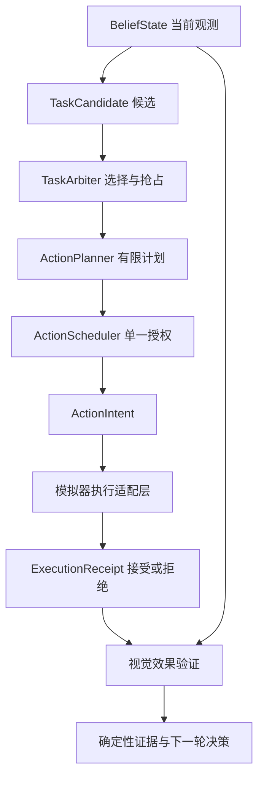

# Task → Plan → Intent → Execution → Verification

`task_runtime.py` 把原始总纲第 10–14 章及第 21 章的一部分边界落成可执行代码：任务候选、确定性仲裁、任务生命周期、有限步骤计划、单一调度器、执行回执和视觉效果判定。它接收 `BeliefState` 与静态职业配置，运行现有独立模拟器的战斗、收集、NPC 对话、跨图任务。

本次实现的任务语法仍是 `fight → collect → talk → travel`。这不是通用任务 DSL、任意地图寻路、全职业技能系统或完整原始总纲的交付。现有三个职业为 `assassin`、`dragon_knight`、`cleric`，路线来自已声明的 1–8 个不同地图 ID；任务运行时不读取地图里的隐藏实体或地形数据。默认路线是 `meadow → cavern`，示例外部路线由 `examples/maps/three-map-fixture.json` 提供。

## 启用与兼容

原有视觉策略仍为默认行为。调用方显式传入 `RuntimeConfig` 才启用结构化运行时；新运行证据使用外层 schema 2 并保存完整配置，历史 schema 1 不因此改变。

```python
from maple_vision.lab import RunConfig, run_episode
from maple_vision.runtime_pipeline import RuntimeConfig
from maple_vision.task_runtime import TaskRuntimeConfig

result = run_episode(
    config=RunConfig(seed=7, job="assassin", max_steps=1500),
    runtime=RuntimeConfig(tasks=TaskRuntimeConfig()),
)
assert result["status"] == "completed"
assert result["independent_goal_check"]
```

运行时不调用 `VisualAgent.decide()`。新的候选生成器、`TaskArbiter`、`ActionPlanner`、`ActionScheduler` 与效果验证器分别承担实际逻辑；专项任务测试把旧策略的 `decide()` 替换成直接抛错，三个职业仍能完成双图与三图任务。

## 数据与责任边界



| 部件 | 接收 | 产出与限制 |
|---|---|---|
| `TaskRuntime.decide` | 强类型 `BeliefState`、当前时钟 | `RuntimeDecision`；不接收图像、模拟器实例或隐藏事件 |
| 候选与仲裁 | 当前观测、静态 `ClassSpec`、有限本地历史 | 带优先级、原因、可见目标的候选；每轮选择一个任务 |
| `ActionPlanner` | 选中候选、当前观测、职业规则、动作时钟 | 1–8 步、最长 60 秒的不可变 `ActionPlan` |
| `ActionScheduler.dispatch` | 已登记的 `ActionIntent`、当前时钟 | `DispatchResult`；拒绝时动作必为 idle；不读取检测框或场景 |
| 执行适配层 | 授权结果中的 `SimAction` | 实际执行后返回接受状态与原因；不得把请求动作假装成已应用动作 |
| `record_execution` | intent ID、实际接受状态、原因、执行时刻 | 唯一绑定的 `ExecutionReceipt`；不接收击杀、掉落或位置真值 |
| 效果验证 | 回执、动作前后视觉观测 | 窄范围可见效果、未知、失败或超时；接受回执不等于效果成功 |
| 实验室独立目标检查 | 模拟器真值与事件 | 判断关卡是否真正完成；该结果不回流任务逻辑 |

`BeliefState.observation` 是本轮真实测量，不用跟踪层保留的旧框补齐未知画面。任务逻辑独立检查当前全局状态、唯一玩家、HP/MP、地图、序号、采集时间和检测置信度。低置信度目标不会触发攻击、拾取、NPC 或传送动作；原观测中的低置信度怪物/掉落仍会阻止“连续空场”计数，不能把不确定的目标当成不存在。

## 公共接口

```python
TaskRuntime(
    job="assassin",
    maps=("meadow", "cavern"),
    *,
    class_spec=None,
    config=None,
)

runtime.decide(belief, now_ms)                         # -> RuntimeDecision
runtime.scheduler.dispatch(intent, now_ms)           # -> DispatchResult
runtime.record_execution(intent_id, accepted, reason, timestamp_ms)
runtime.interrupt(reason, now_ms, terminal=False)     # -> RuntimeDecision
runtime.snapshot()                                  # -> JSON-safe dict
```

`runtime.phase`、`runtime.state`、`runtime.recoveries` 为可读状态。`RuntimeDecision` 提供 `action`、`intent`、`task`、`state`、`reason`、`evidence` 和 `to_dict()`。没有有效 intent 时只能输出 idle；`paused/stopped/failed/completed` 不允许带可执行 intent。证据用不可变 JSON 文本保存，访问属性或 `to_dict()` 返回新容器。

执行层必须遵守以下顺序：

1. 对每张已获取画面调用一次状态估计，包括初始画面、暂停期间和最终画面。
2. 监督器允许时，基于本次缓存的 belief 调用一次 `decide()`。
3. 有 intent 时调用 `scheduler.dispatch()`，只把其 `accepted=True` 时返回的 action 交给执行器。
4. 使用执行器的真实接受状态、原因和执行时刻调用 `record_execution()`。回执只有接受或拒绝，不带真值事件。拒绝动作同样消耗本次 intent。
5. 在下一张观测到达后验证效果。步骤预算耗尽时记录最终 belief，调用终止中断并取 `snapshot()`，不额外执行一次正常策略。

`snapshot()` 仅复制已存在的运行状态；不更新时间、验证旧动作或生成新计划。实验室证据使用 `runtime.state` 和 `runtime_evidence.terminal.state` 保存该快照。步骤预算终止记录 `policy_evaluated=false`、`decision=null` 以及独立的中断结果；与策略真正评估出完成/失败的终止不同。

## 不可变契约

`TaskCandidate`、`TaskInstance`、`ActionPlan`、`ActionIntent` 为冻结的数据类；任务与计划/意图契约显式携带 `schema_version=1`。配置、计划、意图的 `from_dict()` 要求完整且精确的字段集合，拒绝未知字段、错误版本、布尔伪装整数和非法枚举。计划/意图只接受现有 `SimAction` 语法。

| 契约 | 关键字段 |
|---|---|
| `TaskCandidate` | `task_id, kind, priority, reason, target, schema_version` |
| `TaskInstance` | `task_id, kind, status, created_at_ms, updated_at_ms, activations, reason, schema_version` |
| `ActionPlan` | `plan_id, task_id, generation, source_sequence, source_timestamp_ms, source_map, created_at_ms, deadline_ms, steps, schema_version` |
| `ActionStep` | `action, not_before_ms`；时间为相对计划创建时刻的最早开始偏移 |
| `ActionIntent` | `intent_id, plan_id, task_id, generation, step_index, source_sequence, source_timestamp_ms, source_map, created_at_ms, deadline_ms, action, locks, schema_version` |
| `ExecutionReceipt` | `intent_id, accepted, reason, timestamp_ms` |
| `EffectVerification` | `intent_id, status, reason, source_sequence, observed_sequence, timestamp_ms` |

`TaskInstance` 有 `pending/running/paused/completed/cancelled/failed/timeout` 生命周期。任务被选中后激活，被更高优先级任务抢占时暂停；终态任务不能重新激活，更新时间不能倒退。每个地图和任务种类使用一个确定性 ID，当前最多 8 个地图 × 8 种任务，终止时关闭剩余活动或暂停任务。

当前任务优先级：

| 优先级 | 候选 | 触发条件 |
|---:|---|---|
| 1000 | survival | 当前可读资源达到恢复条件，且本地操作时钟允许；牧师可生成 heal |
| 900 | recovery | 连续移动无进展，仍有恢复预算 |
| 500 | buff | 战斗中存在可用目标，MP 条件满足，静态尝试间隔已到 |
| 400 | combat | 当前战斗阶段存在达到置信度门槛的可见怪物 |
| 300 | loot | 当前收集阶段存在合格掉落框 |
| 200 | interaction | 当前对话阶段存在合格 NPC 框 |
| 100 | transition | 当前跨图阶段存在合格 portal 框 |
| 0 | idle | 需要连续确认、等待冷却或当前没有可用目标 |

仲裁首先比较优先级，同级优先保持当前仍合格的任务，再按稳定 ID 排序。生存候选一旦出现即抢占普通任务，取消其剩余计划并增加取消代数。Buff、技能和药品间隔基于本地动作尝试时钟；目前没有视觉 Buff/库存状态，不能据此宣称 Buff 已生效或药品尚有库存。

## 计划、取消与单一执行权

调度器同时最多持有一个计划、一个已登记的待执行 intent 或一个执行中的 intent。资源锁是由动作语义确定的不可变元组，例如 `jump_attack` 同时使用 `combat` 与 `movement`，药品使用 `resource`。由于执行严格串行，即使锁不同也不会并行动作；当前没有多个并行执行线程或调度通道。

`dispatch()` 会逐字段匹配已登记 intent，因此篡改 ID、动作、来源序号、地图、计划、代数或期限均不能授权。已经执行过、取消过、到期或不属于本调度器当前登记项的 intent 返回拒绝，返回动作固定 idle。调度器不负责调用执行器，实验室适配层把这项授权放在真实执行路径上。

后续步骤只能在上一步回执到达后登记，并使用严格更大的观测序号、非倒退的采集时间、原计划地图和当前代数。即使仍在同一复合计划中，也不能复用或倒退来源帧。intent 有效期取以下三者的最小值：计划期限、当前时间加 intent TTL、来源采集时间加最大画面年龄。到达期限即拒绝，不把过期画面当作可执行的新依据。

取消会清除计划、待执行和执行中的登记，并增加 generation；旧 intent 永不因后续恢复而复活。暂停、不可用 belief、感知来源变化或同图 epoch 变化会切断复合动作上下文。来源变化也将尚未验证的旧效果收束为 UNKNOWN；暂停会重置连续空场计数，不能把暂停前后的少量空帧拼成连续证据。正常地图转换由声明的路线和 `travel` 阶段处理，其他地图变化停止为失败。

标飞的示例复合计划是 `转向移动 → 至少 50ms 后 jump_attack`。后一步必须基于新帧重新检查站立条件；如果已经离地，取消旧计划重新规划。`jump_attack` 是模拟器原有原子动作，不能在它之前再发送一次 jump。单个计划最多 8 步，当前职业规划器只生成单步或这一种两步计划。

这些登记规则限定在一个运行时会话内；它们是执行授权与可复现性约束，不是跨进程密码学签名或可恢复的分布式事务协议。外部任意代码仍可绕过适配层直接调用模拟器，因此系统测试另外验证实际运行路径确实调用调度器。

## 效果证据的含义

视觉验证只对同源、KNOWN、置信度合格、序号更新、时间合理且在效果窗口内的观测给出正面结果。动作前的序号、采集时间、地图必须与 intent 匹配。接受回执只表示执行器接受了一次调用；输入被故障注入替换为 idle 时，回执可能仍为 `accepted=true`，但目标动作的效果依旧未知或超时。

| 状态 | 当前使用范围 |
|---|---|
| `SUCCESS` | 观测到对应方向移动、jump 上升、HP/MP 增加、对话新打开或 portal 后地图变化；仅陈述该可见条件 |
| `LIKELY_SUCCESS` | climb 后垂直位移；jump_attack 后上升但攻击效果不可验证 |
| `UNKNOWN` | attack、loot、buff、idle 缺乏足够可见效果字段；来源变化、非 portal 地图变化或中断留下的不确定性 |
| `FAILED` | 实际执行器明确拒绝该 intent |
| `TIMEOUT` | 在配置窗口内没有得到足够的可见效果证据 |

怪物或掉落从画面消失不会确认击杀或拾取；遮挡、UNKNOWN、重复帧、来源切换也不能确认它们。任务的 `completed` 可以表示“连续多个有效画面满足阶段条件”，与最终独立目标检查不同。实验室会继续用隐藏真值检查全部怪物、掉落、各图对话与生存状态，防止视觉阶段完成冒充真实任务成功。`SUCCESS` 不是经过校准的因果概率，HP 增加或移动也可能有外部原因，因此证据保留具体原因而不泛化成任务成功。

## 有界失败与配置

```python
config = TaskRuntimeConfig()
assert TaskRuntimeConfig.from_dict(config.to_dict()) == config
```

| 设置 | 默认值 | 限制/用途 |
|---|---:|---|
| `intent_ttl_ms` | 250 | 1–60000；不能超过计划期限 |
| `plan_timeout_ms` | 2000 | 1–60000；计划执行窗口 |
| `effect_timeout_ms` | 500 | 1–60000；等待新视觉效果的窗口 |
| `max_observation_age_ms` | 250 | 1–60000；任务可用画面年龄，达到上限即拒绝 |
| `max_task_steps` | 1000 | 1–100000；单任务阶段最大有效决策步数 |
| `clear_confirmations` | 4 | 1–1000；连续有效空场/无掉落确认 |
| `max_unknown_steps` | 12 | 1–100000；直接调用任务运行时的连续不可用 belief 预算 |
| `max_denied_actions` | 6 | 1–100000；执行拒绝预算，已接受的非 idle 动作重置 |
| `max_attack_attempts` | 12 | 1–1000；可见怪物数量不变时的攻击尝试预算 |
| `stuck_steps` | 8 | 1–1000；连续请求移动而没有可见位移的判断窗口 |
| `max_recoveries` | 2 | 0–100；有限恢复 jump 的次数 |
| `history_limit` | 128 | 8–1024；生命周期历史与待验证效果上限 |
| `minimum_detection_confidence` | 0.5 | 0–1；玩家、交互目标和地面框门槛 |

外部 Supervisor 暂停时直接调用 `interrupt()`，不会假装运行了一次正常策略；持续不可用输入的全局停止由监督器负责。直接使用 `TaskRuntime.decide()` 时另有 `max_unknown_steps` 停止预算。正常决策还受阶段步数、拒绝次数、攻击无进展、移动恢复次数与实验室总步数限制。

内存不保存图像或无限轨迹。任务实例数、计划长度、当前意图、生命周期历史和待验证队列都有明确上限。`snapshot()` 和每轮证据包含当前任务、候选选择、计划/意图、最后回执、未决效果、效果结果与生命周期事件，能够解释暂停、取消、超时及终止。

## 验证入口

```bash
python -m pytest tests/test_task_runtime.py tests/test_v05_review.py -q
python -m ruff check src/maple_vision/task_runtime.py tests/test_task_runtime.py
python -m mypy src/maple_vision/task_runtime.py
```

专项测试覆盖严格配置与序列化、不可变生命周期、优先级抢占、单执行权、intent 篡改/重放/过期/取消、复合步骤新帧要求、回执身份、视觉效果不足与超时、暂停清理、来源切换、拒绝预算、无进展恢复、阶段超时、内存上限和确定性证据。实际像素任务覆盖三个职业 × 内置两图/外部三图，并断言全部独立目标与真实跨图次数；独立审查还覆盖实验室真实授权拒绝、冻结输入实际回执、N+1 帧状态更新及动作重放/重推理证据篡改。

收尾检查曾实际发现快照隔离缺陷：`recent_lifecycle` 复制了列表，但内部事件字典仍引用运行时历史，修改快照副本会污染后续快照。此前通过的测试没有覆盖这一嵌套容器反例。现已逐事件深拷贝，并在快照测试中直接修改副本的事件字段以验证隔离；修复前的正式验证记录需要与修复后最终源码验证分开保存，不能用前者替代最终验收。

这批验证证明的是合成场景中声明的任务子集与执行边界。没有新增模型训练、修改冻结实验、宣称真实游戏接入或延长已有长期稳定性结论。
