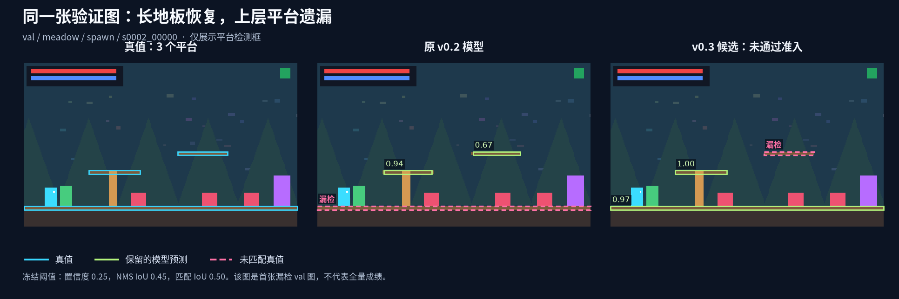

# v0.3 地形模型实验：长地板改善，候选拒绝推广

**本轮唯一候选未通过预先冻结的验证门禁。** 它检出了全部 192 个全宽地板，平台总体召回从旧模型的 383/576 提高到 472/576，但仍低于要求的 0.98。14 项数值门禁通过 13 项，不能据此宣布整体通过。候选保存在 [examples/terrain-candidate](../examples/terrain-candidate/) 供复核；原已验收的 `examples/lifecycle-model` 混合管线及默认像素地形保持不变。

下面区分正式验证与拒绝后的诊断。**没有追加训练，没有更改阈值，没有对新 test 预测或评分，也没有执行该候选的推广场景套件、任务重推理或资源 soak。** 这些是按协议关闭的分支。工程工具的测试和发布状态另见 [RELEASE_0_3_ACCEPTANCE.md](RELEASE_0_3_ACCEPTANCE.md)。[固定决定](../reports/release-0.3.0/model-decision.json)

## 1. 实验问题、预算和身份

旧结构的实际 DFL bins 为 0…7、stride 为 4/8，单框宽度上限为 112px；对宽 320px 的地板，单框 IoU 上限仅为 0.35。只追加 stride32 也不能解决当前薄地板问题：实际分配器没有在该地板附近接受这一层的锚点。本轮先验证候选锚点及每条边的可回归距离，再启动训练。[结构审查及独立反例](TERRAIN_AUDIT.md)

唯一候选保留旧 backbone，追加一个 stride2 Conv，使用实际 stride4/8/16、`reg_max=16`，共 398357 参数。新 val 的 576 个平台和 192 个梯子均至少存在一个完整四边训练目标无需截断的候选锚点。全宽地板在 stride16 有 20 个合格中心，其中 10 个能覆盖完整目标；顶部距离为零，因此不能把这一结构结果直接当作学成精度。[新 val 结构报告](../reports/release-0.3.0/terrain-candidate-audit.json)

[预注册](../reports/release-0.3.0/preregistration.json)于 **2026-11-24 21:51:15.597437（北京时间，UTC+08:00）** 固定，早于候选训练及候选验证；冻结前已查看旧模型在新 val 上的基线。预算为一次从零训练、40 epoch、320px、batch8、seed42、CPU 两线程。没有第二配置或结果出来后的延长训练；`best.pt` 使用既有训练器的验证 fitness 选择。

| 固定输入或产物 | 身份 |
|---|---|
| 数据 | `lifecycle-v1`，seed2026112603，18 会话×48 帧，864 帧、7091 个可见对象 |
| train / val / test | 10/4/4 会话，480/192/192 帧 |
| 数据 manifest SHA-256 | `f73d7390980fa6aedea3b3a12ada2f0a8f3658519e0ca435ca93414bbd02aac4` |
| 候选配置 SHA-256 | `b4a42896b69b9a55d1fc2324e2c4b55cc12d8fdd4ac69ab26583957b00839111` |
| 候选 best.pt SHA-256 | `85a4b789dae6b33940f1f5cf22b7c1f6a080f595f23925cb7e589ea784fd4748` |
| 候选 ONNX SHA-256 | `be5cd99bce0f52b0cdfc7e033251f2c919e14d203c8b72d394a18d7a067751f0` |
| 同集旧模型 ONNX SHA-256 | `7e9f61576f63be400909db6f9eb6cb89b5b935385d01a24155c7f765d2beb6e3` |

训练实际用时 **1467.923792 秒**。ONNX 输入为 `[1,3,320,320]`、输出为 `[1,11,8400]`。正式40epoch训练与val评分期间，五项冻结源码保持预注册字节；历史源码保存在提交 [`ff357c8`](https://github.com/www1350/maple-vision-platform/commit/ff357c8951da8e84265d31c5a8b86a48934a4f01)。1730 个源数据与实际训练副本文件逐字节一致，训练入口执行了输入副本和配置的前后检查。实验结束后发现的日志流生命周期修复属于独立工程更正，未参与也不追溯记入本次实验，原始模型和报告保持原样。[训练](../reports/release-0.3.0/training.json) · [导出](../reports/release-0.3.0/export.json) · [输入核对](../reports/release-0.3.0/training-input-provenance.json)

## 2. 正式 val 成绩与拒绝理由

两个模型均在本轮同一份 **192 帧、1569 个真值**上评估。固定置信度为 0.25、NMS IoU 为 0.45、匹配 IoU 为 0.5；同图同类按置信度排序一对一匹配。macro AP50 是置信度截断后的 101 点插值单 IoU 指标，`map50_95` 为 `null`，不等同 COCO mAP50–95。

| 同一新 val 的指标 | 已交付 v0.2 模型 | 本轮候选 |
|---|---:|---:|
| TP / FP / FN | 1371 / 1 / 198 | 1459 / 1 / 110 |
| micro precision | 0.999271 | 0.999315 |
| micro recall | 0.873805 | 0.929892 |
| macro AP50 | 0.944830 | 0.964625 |
| platform recall | 383/576 = 0.664931 | **472/576 = 0.819444** |
| ladder recall | 191/192 = 0.994792 | 190/192 = 0.989583 |
| loot recall | 96/100 = 0.96 | 96/100 = 0.96 |
| player / monster / portal / npc recall | 各 1.0 | 各 1.0 |
| `detect(frame)` p95 | 17.490452ms | 24.986154ms |

上述延迟来自正式计时：ORT CPU、intra-op1，排除三次预热，192 次调用，包括预处理、推理和解码，不含 PNG I/O。它是当前机器的工程测量；后续诊断没有重新发布速度成绩。[旧模型完整 val](../reports/release-0.3.0/lifecycle-baseline-validation.json) · [候选完整 val](../reports/release-0.3.0/terrain-model-validation.json)

候选的全宽地板子组有 **192 个真值、192 个匹配、0 个遗漏**。匹配后原图坐标误差如下：

| 地板几何指标 | p95 绝对误差 | 冻结要求 |
|---|---:|---:|
| 顶边 | 0.0000314776px | ≤1px |
| 左端点 | 0.4719100952px | ≤4px |
| 右端点 | 0.1517791748px | ≤4px |

这些极小误差来自自建合成画面的固定像素几何，不能外推真实素材精度。地板几何先匹配全部平台、再按真值分组；不能把漏检当作零误差。旧 schema2 基线没有这一几何分组字段，本文没有为它补造整组经验成绩。

**唯一失败的数值门禁是 platform recall≥0.98。** 梯子、全宽地板及其三项边界误差、五个动态类、macro AP50、micro precision、部署 p95 共其余 13 项通过。召回增加 89 个平台目标是有效改善，但总体仍缺 104 个，门禁结果保持失败。[原始门禁](../reports/release-0.3.0/validation-gates.json)

## 3. 全部 104 个遗漏来自哪里

正式报告的少量失败示例不足以回答“是否全部漏同一平台”。拒绝后额外执行了一次 **仅 val 的完整诊断**，逐一记录 1569 个真值及匹配情况，其中 576 个平台同时保存原始检测头的诊断摘要。重算结果与正式报告的整个 aggregate metrics 字典完全相同，平台仍为 **472 TP、0 FP、104 FN**。

| 地图及平台真值框，原图 xyxy 像素 | GT | 匹配 | 遗漏 |
|---|---:|---:|---:|
| cavern 地板 `[0,168,320,172]` | 88 | 88 | 0 |
| cavern 下平台 `[86,118,152,122]` | 88 | 88 | 0 |
| cavern 上平台 `[212,94,270,98]` | 88 | 88 | 0 |
| meadow 地板 `[0,168,320,172]` | 104 | 104 | 0 |
| meadow 下平台 `[76,126,136,130]` | 104 | 104 | 0 |
| **meadow 上平台 `[180,104,238,108]`** | **104** | **0** | **104** |

坐标表按像素四舍五入；账本保留 YOLO 文本反算的全部浮点精度。结论来自全部真值：**104 张 meadow 验证图各漏掉这个宽 58px、高 4px 的上平台；cavern 的 264 个平台全部匹配。** 四个会话各有 26 个该平台遗漏。

遗漏覆盖全部六个生命周期阶段：spawn8、combat24、loot24、cleared36、dialogue8、transition4，合计104。它并不限于战斗或对话遮挡。由于所有 split 仍共享这两张地图，这只能证明当前验证集合中的系统性遗漏，不能据此断言新地图会出现同样模式。[完整诊断摘要](../reports/release-0.3.0/diagnosis-val-platforms.json) · [逐真值账本](../reports/release-0.3.0/diagnosis-ground-truth-ledger.jsonl)

## 4. 是置信度低，还是原始框没有定位到目标

诊断沿用实际 ONNX 适配器的预处理、同一 native session 和冻结解码规则，每帧只调用一次模型。另在内存中检查输出的 8400 个原始框：还原至原图、裁到图像边界、排除非有限或无效面积框，再计算与遗漏真值的 IoU。这里的“原始”指置信度过滤和 NMS **之前**已经解码的框，不是未经 DFL 解码的 logits。

| 对 104 个遗漏真值逐个检查 | 实际结果 |
|---|---|
| 不限赢家类别，任意原始框最佳 IoU | 最小 0.0685791，中位数 0.0685920，最大 0.0686244 |
| 赢家类别为 platform 的原始框最佳 IoU | 最小 0.0677287，中位数 0.0677878，最大 0.0678042 |
| 原始框达到 IoU≥0.5 | **每个遗漏目标均为 0 个** |
| platform 赢家且分数≥0.25 的最佳 IoU | 全部为 0 |

因此，这个导出模型并没有把“已经定位正确的平台框”仅仅挡在置信度或 NMS 门外。即使检查所有分数和所有赢家类别，几何重叠也远未达到 0.5。此检查没有扫描或降低任何部署阈值，不能把诊断当作新的通过成绩。

首张遗漏图中，最佳 platform 赢家原始框约为 `[180.448,77.902,240.125,134.765]`，高度约 56.86px，而目标高度为4px；IoU 约0.06780，platform 分数约 `3.80e-5`。这具体显示了定位差异，**没有证明它为什么学成这样**。

结构预检已经为这类目标找到完整可回归锚点，所以不能再沿用旧模型“完整框在表达范围之外”的解释。另一方面，本轮没有保存每个训练 GT 的最终正样本分配、损失和梯度轨迹；现有证据也不足以认定 TAL 分配、loss 权重、初始化或优化过程中的某一项就是根因。当前可支持的结论是：**结构覆盖成立，但该已训练模型对这个平台的定位没有学成；失败不能仅由后处理门槛解释。**

## 5. 首张遗漏图的可视对照



图片固定选择正式 val 顺序中第一张含遗漏平台的图：`images/val/s0002_00000.png`，meadow、spawn、sequence0。左侧是真值，中间为旧模型，右侧为本轮候选，只显示平台框。旧模型在这一帧保留两个短平台、漏地板；候选保留地板和下平台、漏上平台。颜色及置信度仅解释这一帧，整体结论以全量账本为准。

该示意图由项目自建 fixture 画面和真实检测坐标绘制，92,211 bytes；不是生成式重绘，也没有修改素材来突出差异。旧模型仅为这张图额外调用一次，没有再次跑完整基线。[原图及预测坐标](../reports/release-0.3.0/diagnosis-first-miss.json) · [图片哈希和选择规则](../reports/release-0.3.0/diagnosis-first-miss-comparison.json)

## 6. 诊断边界与可复核文件

诊断发生在正式拒绝之后，共 **192 次候选调用＋1 次旧模型调用**，全部限于 val。模型字节、manifest、ORT 实际设置、数据 manifest、逐图和标签哈希均与冻结身份核对，正常预测重现了正式所有 aggregate 指标。没有替换原正式报告；诊断时可能与其他 QA 共享 CPU，因此不报告其时延。

| 文件 | 用途 |
|---|---|
| [diagnosis-val-platforms.json](../reports/release-0.3.0/diagnosis-val-platforms.json) | 身份、调用次数、完整聚合复现、地图/阶段/会话/几何分组及原始框统计 |
| [diagnosis-ground-truth-ledger.jsonl](../reports/release-0.3.0/diagnosis-ground-truth-ledger.jsonl) | 1569 行逐真值证据；576 个平台附原始框摘要，含全部104个遗漏 |
| [diagnosis-val-platforms.py.txt](../reports/release-0.3.0/diagnosis-val-platforms.py.txt) | 本次固定路径诊断脚本，使用现有适配器和一般评估器，拒绝覆盖原输出 |
| [diagnosis-first-miss.json](../reports/release-0.3.0/diagnosis-first-miss.json) | 首张遗漏帧的所有真值及两个模型保留预测 |
| [diagnosis-render-comparison.py.txt](../reports/release-0.3.0/diagnosis-render-comparison.py.txt) | 从已保存坐标绘图，无额外模型调用 |

完整 ledger 的 SHA-256 为 `1fa1008275b4de642e4814934686a280befa578532a998fb7295e8a354f9541a`。这些哈希用于内容完整性核对，不是独立可信签名。脚本以 `.py.txt` 保留执行时原文，作为诊断证据而非安装入口；可使用 `python 文件路径` 执行。脚本保留本次工作目录和固定输入身份；已有输出应保留，不能反复覆盖后将新结果冒充原证据。

可用标准库门禁脚本复核已保存报告，不必重新训练或预测：

```bash
python scripts/check_terrain_experiment.py \
  --preregistration reports/release-0.3.0/preregistration.json \
  --candidate reports/release-0.3.0/terrain-model-validation.json \
  --baseline reports/release-0.3.0/lifecycle-baseline-validation.json \
  --output artifacts/terrain-gates-independent-review.json
```

使用全新输出路径；预期退出码 **1**，`platform_recall.passed=false`，`model_promotion_granted=false`。这复核报告内容与身份声明，不重新推理，也不能独立证明实验时间顺序。

## 7. 后续研究需要什么证据

本轮已完成冻结预算，下一步研究应先解释现有遗漏，而不是立即追加 epoch 或放宽门禁：

1. **采集实际训练分配证据。** 在新的、另行冻结的研究中，按 GT 记录各层 eligible、最终 top-k/冲突消解后的正样本数、质量权重和各边回归目标；分别比较 meadow 上平台、同图下平台与 cavern 上平台。当前工具检查的是候选和表达范围，未测最终训练分配。
2. **定位学习差异。** 若分配确有有效正样本，再核对对应 box/DFL/class loss、回归梯度及不同 checkpoint 的定位变化；先区分“没获得有效监督”和“有监督但优化失败”。任何诊断训练都应声明新的预算和版本，不能混入本次单候选结果。
3. **保持独立准入。** 后续改动须重新固定数据、候选和阈值，仍分别验收所有平台召回、地板几何、动态类与部署成本。结构预检可用于拒绝无效结构，不能替代质量门禁或实际闭环任务。

本轮 test 保持未预测、未评分；完整性校验和训练私有副本复制曾读取其文件字节，两者应明确区分。192 张 val 图片来自四个相关会话，两张内置地图仍出现在各 split；不存在未见地图或真实游戏域的验收结论。模型对象来源的隔离与运行复验见 [MODEL_TERRAIN.md](MODEL_TERRAIN.md)，几何统计定义见 [TERRAIN_EVALUATION.md](TERRAIN_EVALUATION.md)。官方客户端控制、真实规则与素材验证、梯子导航、24 小时墙钟运行及完整 v8 交付均未因本次研究而完成。
